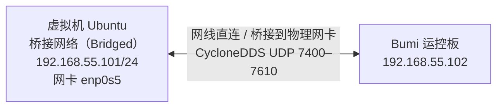

# Bumi 机器人虚拟机连接配置手册

> 作者：祁果 ｜ 仓库：[77-GGG/bumi-handbooks](https://github.com/77-GGG/bumi-handbooks) ｜ PDF 版：[bumi-vm-setup-handbook.pdf](bumi-vm-setup-handbook.pdf)
>
> 本文件由 LaTeX 工程 `handbook/` 的章节源码逐段转换而成，内容与 PDF（19 页）一致，供全文检索与 AI 阅读使用。

## 目录

- [前言](#前言)
- [第零章 安装虚拟机](#第零章-安装虚拟机)
  - [0.1 第 0 步：按主机架构选择软件与镜像](#01-第-0-步按主机架构选择软件与镜像)
  - [0.2 Windows x86_64：使用 VMware 与 amd64 镜像](#02-windows-x86_64使用-vmware-与-amd64-镜像)
  - [0.3 MacOS（Apple Silicon）：使用 Parallels Desktop](#03-macosapple-silicon使用-parallels-desktop)
  - [0.4 安装完成后的检查](#04-安装完成后的检查)
- [第一章 目标与整体链路](#第一章-目标与整体链路)
  - [1.1 关键参数](#11-关键参数)
  - [1.2 为什么必须桥接](#12-为什么必须桥接)
- [第二章 把虚拟机网络改为桥接](#第二章-把虚拟机网络改为桥接)
  - [2.1 第 1 步：关闭虚拟机](#21-第-1-步关闭虚拟机)
  - [2.2 第 2 步：Parallels 中把网络改为桥接](#22-第-2-步parallels-中把网络改为桥接)
- [第三章 配置静态地址](#第三章-配置静态地址)
  - [3.1 第 3 步：启动虚拟机并确认网卡名](#31-第-3-步启动虚拟机并确认网卡名)
  - [3.2 第 4 步：备份网络配置文件](#32-第-4-步备份网络配置文件)
  - [3.3 第 5 步：设置 IPv4 地址和子网掩码](#33-第-5-步设置-ipv4-地址和子网掩码)
  - [3.4 第 6 步：应用配置](#34-第-6-步应用配置)
  - [3.5 第 7 步：确认地址和掩码已生效](#35-第-7-步确认地址和掩码已生效)
- [第四章 放行端口并测试连通](#第四章-放行端口并测试连通)
  - [4.1 第 8 步：放行 DDS 通信端口](#41-第-8-步放行-dds-通信端口)
  - [4.2 第 9 步：测试能否连上机器人](#42-第-9-步测试能否连上机器人)
- [第五章 运行程序验证 DDS 通信](#第五章-运行程序验证-dds-通信)
  - [5.1 第 10 步：运行程序验证 DDS 通信](#51-第-10-步运行程序验证-dds-通信)
- [附录 A 常见故障速查](#附录-a-常见故障速查)
- [附录 B 恢复原配置](#附录-b-恢复原配置)

---

# 前言

有时我们手上只有一台笔记本，希望在虚拟机里准备一套 Ubuntu 环境来连接 Bumi；也有可能机器人已经有一块算力板，但仍想在隔离的虚拟机中做实验。这两种做法都会遇到同一个问题：虚拟机默认走 NAT 或共享网络，地址落在 `10.211.55.x` 这类网段，而 Bumi 运控板只接受 `192.168.55.0/24` 上的直连通信。

因此，本手册只讲一件事：把虚拟机的网络从共享模式改成桥接模式，让虚拟机像一台独立的物理机一样接入机器人所在的网段，并最终完成 DDS 通信验证。操作环境以 Parallels Desktop 跑 Ubuntu、笔记本用网线直连 Bumi 为例，Windows 上的 VMware 思路相同。

内容按“先看懂再动手”的顺序组织。第一章说明目标地址、网卡与整体链路；第二章把虚拟机网络改成桥接；第三章配置静态地址；第四章放行 DDS 端口并测试连通；第五章运行程序验证通信。附录提供常见故障速查和恢复原配置的方法。

每一步都给出操作命令、预期结果和常见问题。命令中的网卡名 `enp0s5`、地址 `192.168.55.101` 请按自己的实际环境替换：网卡名用 `ip -brief addr show` 查看，地址不能与运控板或其他设备冲突。

调试时请全程使用机器人吊架，确保机器人在切换控制模式前得到稳定支撑。

---

# 第零章 安装虚拟机

> **本章导读**
>
> - 按主机 CPU 架构选择虚拟机软件与 Ubuntu 镜像。
> - 新建虚拟机并完成 Ubuntu 安装。
> - 确认系统版本与网络初始状态。

开始配置网络之前，先在主机上装好虚拟机软件并新建一台 Ubuntu 虚拟机。虚拟机软件和 Ubuntu 镜像都要与主机的 CPU 架构对应，否则会出现装不上或运行极慢的情况。

## 0.1 第 0 步：按主机架构选择软件与镜像

先确认主机的 CPU 架构，再按下表选择：

| 主机系统 | CPU 架构 | 虚拟机软件与 Ubuntu 镜像 |
| --- | --- | --- |
| Windows | x86_64 | **VMware**；Ubuntu 22.04.5 **amd64** 桌面版 |
| MacOS（Apple Silicon） | arm | **Parallels Desktop**；Ubuntu 22.04.5，**镜像由 Parallels Desktop 直接提供** |

> **提示：架构不能混用**
>
> x86_64 主机要用 amd64 镜像，arm 主机要用 arm64 镜像。在 Apple Silicon 上运行 amd64 镜像只能靠指令翻译，速度慢且容易出错，因此 Parallels Desktop 直接提供适配 arm 架构的 Ubuntu 22.04.5 镜像，用它即可。

## 0.2 Windows x86_64：使用 VMware 与 amd64 镜像

1. 安装 VMware（VMware Workstation Player 或 Pro）。
2. 下载 Ubuntu 22.04.5 桌面版 amd64 镜像：

```text
https://mirrors.tuna.tsinghua.edu.cn/ubuntu-releases/22.04/ubuntu-22.04.5-desktop-amd64.iso
```

3. 在 VMware 中新建虚拟机，选择「安装程序光盘映像文件」，指向下载好的 `ubuntu-22.04.5-desktop-amd64.iso`。
4. 按向导分配磁盘与内存（建议磁盘不少于 40 GB，内存不少于 4 GB），完成 Ubuntu 安装。

> **预期结果**
>
> - Ubuntu 22.04.5 桌面正常启动，能登录并打开终端。
> - 终端执行 `uname -m` 输出 `x86_64`。

## 0.3 MacOS（Apple Silicon）：使用 Parallels Desktop

1. 安装 Parallels Desktop。
2. 新建虚拟机时，Parallels Desktop 会在「免费系统」列表中**直接提供 Ubuntu 22.04.5 镜像**，选择它即可，无需自己下载。
3. 按向导分配磁盘与内存，完成 Ubuntu 安装。

> **预期结果**
>
> - Ubuntu 22.04.5 桌面正常启动，能登录并打开终端。
> - 终端执行 `uname -m` 输出 `aarch64`。

## 0.4 安装完成后的检查

在虚拟机终端里确认系统版本与网卡情况：

```bash
lsb_release -a
uname -m
ip -brief addr show
```

> **预期结果**
>
> - 系统版本显示 Ubuntu 22.04.5 LTS。
> - 能列出至少一块网卡；此时地址通常还在 `10.211.55.x` 一类的共享网段，属于初始状态，第二章会把它改成桥接。

> **常见问题：Parallels Desktop 里找不到 Ubuntu 镜像**
>
> 在「新建虚拟机」窗口的免费系统列表中查找 Ubuntu 22.04.5；若列表未加载，确认软件已联网并登录，再重开新建向导。

> **常见问题：下载的 iso 装不上或运行极慢**
>
> 镜像架构与主机 CPU 不匹配。Windows x86_64 请用 amd64 镜像，Apple Silicon 请用 Parallels Desktop 提供的 arm 镜像。

---

# 第一章 目标与整体链路

> **本章导读**
>
> - 明确虚拟机需要达到的网络状态。
> - 认识直连链路中的地址、掩码与网卡。
> - 了解桥接与共享网络的区别。

配置的目标只有一个：虚拟机通过网线与 Bumi 运控板（`192.168.55.102`）直连通信。虚拟机本身使用 `192.168.55.101`，子网掩码 `255.255.255.0`（即 `/24`），示例网卡名为 `enp0s5`。

## 1.1 关键参数

| 项目 | 值 | 说明 |
| --- | --- | --- |
| 运控板 IP | `192.168.55.102` | 直连通信的目标地址 |
| 虚拟机地址 | `192.168.55.101` | 子网掩码 `255.255.255.0`（`/24`） |
| 网卡名 | `enp0s5` | 以 `ip -brief addr show` 实际输出为准 |
| 虚拟机软件 | Parallels Desktop（Windows 端为 VMware） | 网络均设置为**桥接模式** |
| 通信中间件 | CycloneDDS RTPS | 端口范围 `7400:7610/udp` |



图 1.1　虚拟机桥接后与运控板的直连链路。

## 1.2 为什么必须桥接

虚拟机软件默认把网卡接在 NAT 或共享网络上。此时虚拟机会拿到 `10.211.55.x` 一类的私有地址，经过宿主机做地址转换后再访问外部，机器人所在的 `192.168.55.0/24` 网段对它并不可见，也就不可能直连。

桥接模式把虚拟机网卡直接接到宿主机的物理网卡上，使虚拟机成为该物理网段中的一台独立主机。这样虚拟机才能配置 `192.168.55.101`，并与 `192.168.55.102` 直接收发报文。

> **提示：桥接到哪块网卡**
>
> 一定要选择**插了机器人网线的那块物理网卡**，而不是“默认适配器”。选错会桥接到 Wi-Fi，虚拟机拿不到机器人网段的地址。

---

# 第二章 把虚拟机网络改为桥接

> **本章导读**
>
> - 先关机再改网络，避免配置中途断开。
> - 在 Parallels 中把网络源改为桥接，并指定物理网卡。
> - Windows 端 VMware 同样使用桥接模式。

改网络设置前先关闭虚拟机。运行中修改网络适配器，可能导致配置只写入一半就断开。

## 2.1 第 1 步：关闭虚拟机

在虚拟机终端执行：

```bash
sudo poweroff
```

> **预期结果**
>
> - 虚拟机正常关机，Parallels 控制中心中该虚拟机状态变为已停止。

## 2.2 第 2 步：Parallels 中把网络改为桥接

1. 打开 Parallels Desktop 控制中心，选中该虚拟机，点击齿轮图标打开「配置」。
2. 左侧选择「硬件」→「网络 1」。
3. 「源」下拉框选择 **桥接网络（Bridged Network）**。
4. 「桥接到」下拉框选择**插了机器人网线的那块物理网卡**（如 Ethernet、en0、USB 网卡）。（经测试，网卡名称为 AX88179B）
   不要选「默认适配器」，否则可能桥接到 Wi-Fi 上。
5. 点击「确定」。
6. Windows 端使用 VMware，依然是将网络设置为桥接模式，让虚拟机直接访问机器人运控板上的网卡。

> **预期结果**
>
> - 网络源显示为「桥接网络」，桥接目标为插了机器人网线的物理网卡。

> **常见问题：不知道桥接到哪块网卡**
>
> 在宿主机上查看正在使用的那块有线网卡。Parallels 会把它列在「桥接到」下拉框中；名称可能是 Ethernet、en0 或具体的 USB 网卡型号（如 AX88179B）。

> **常见问题：只有 Wi-Fi，没有有线网卡**
>
> 桥接需要一块有线物理网卡来承载机器人网线。请用 USB 转以太网网卡，并把机器人网线插到该网卡上。

---

# 第三章 配置静态地址

> **本章导读**
>
> - 启动虚拟机并确认有线网卡名称。
> - 备份 netplan 配置，写入地址 `192.168.55.101/24`。
> - 应用配置并确认地址与路由生效。

虚拟机桥接后，需要把有线网卡的地址固定在 `192.168.55.0/24` 网段。Linux 上网络由 netplan 管理，修改前先备份原文件。

## 3.1 第 3 步：启动虚拟机并确认网卡名

启动虚拟机，打开终端执行：

```bash
ip -brief addr show
```

> **预期结果**
>
> - 输出中能看到一个有线网卡，示例环境中其名称为 `enp0s5`。
> - 若不是 `enp0s5`，后面命令里的 `enp0s5` 换成实际名字。

## 3.2 第 4 步：备份网络配置文件

```bash
sudo cp /etc/netplan/00-installer-config.yaml /etc/netplan/00-installer-config.yaml.bak
```

> **预期结果**
>
> - 同目录下生成 `00-installer-config.yaml.bak`，恢复时使用。

## 3.3 第 5 步：设置 IPv4 地址和子网掩码

```bash
sudo nano /etc/netplan/00-installer-config.yaml
```

把内容改成（**只能用空格缩进，每级 2 个空格，不能用 Tab**）：

```bash
network:
  version: 2
  ethernets:
    enp0s5:
      dhcp4: true
      addresses: [192.168.55.101/24]
```

说明：`/24` 就是子网掩码 `255.255.255.0`。
不要写 `gateway4` 或默认网关，直连没有路由器，写了会导致虚拟机断网。

保存退出（Ctrl+O 回车，Ctrl+X）。

## 3.4 第 6 步：应用配置

```bash
sudo netplan try
```

无报错则按回车确认；然后：

```bash
sudo netplan apply
```

如果 `netplan try` 报语法错误，说明缩进不对，重新按第 5 步检查。

（如果只想临时试一下、不写配置文件，可以用这条，重启后失效：）

```bash
sudo ip addr add 192.168.55.101/24 dev enp0s5
```

> **预期结果**
>
> - `netplan try` 无报错，回车后配置保留；`netplan apply` 退出码为 0。

## 3.5 第 7 步：确认地址和掩码已生效

```bash
ip -brief addr show enp0s5
ip route
```

应看到：

```bash
enp0s5   UP   192.168.55.101/24
192.168.55.0/24 dev enp0s5 proto kernel scope link src 192.168.55.101
```

> **预期结果**
>
> - 网卡地址为 `192.168.55.101/24`。
> - 路由表中存在 `192.168.55.0/24` 且出口为 `enp0s5`。

> **常见问题：ip addr 还是 10.211.55.x**
>
> 第 2 步的桥接没生效，重新选物理网卡并重启虚拟机。

> **常见问题：ip route 里没有 192.168.55.0/24**
>
> 第 6 步没有真正生效，重新 `sudo netplan apply`，检查缩进。

---

# 第四章 放行端口并测试连通

> **本章导读**
>
> - 检查并放行 DDS 通信所需的 UDP 端口。
> - 用 ping 和 ARP 表确认到运控板的链路。

在运行控制程序之前，先确认主机防火墙没有拦截 DDS 通信，再从网络层验证到机器人是否可达。

## 4.1 第 8 步：放行 DDS 通信端口

```bash
sudo ufw status verbose
```

如果显示 `Status: active`，执行：

```bash
sudo ufw allow 7400:7610/udp comment 'CycloneDDS RTPS'
sudo ufw allow 22/tcp
sudo ufw reload
sudo ufw status numbered
```

> **预期结果**
>
> - 规则列表中出现 `7400:7610/udp` 与 `22/tcp`。
> - 若防火墙本就未启用，可跳过本步。

## 4.2 第 9 步：测试能否连上机器人

```bash
ping -c 3 192.168.55.102
ip neigh show dev enp0s5
```

> **预期结果**
>
> - ping 应有 0% packet loss。
> - ARP 表里能看到 `192.168.55.102` 对应的 MAC 地址。

> **常见问题：ping 不通**
>
> 检查网线、机器人是否上电、双方掩码是否都是 `/24`、桥接网卡是否选错。

---

# 第五章 运行程序验证 DDS 通信

> **本章导读**
>
> - 在虚拟机中运行示例程序。
> - 通过初始化日志确认与机器人通信成功。

网络层通了以后，最后一步是用示例程序验证 DDS 通信。

## 5.1 第 10 步：运行程序验证 DDS 通信

运行部署程序以验证通信是否正常，例如：

```bash
cd /home/parallels/21.Bumi_sdk
sudo ./build/example_policy_keyboard
```

> **预期结果**
>
> - 终端出现 `[DEBUG]: init finish`，表示和机器人通信成功。

> **常见问题：ping 通但程序卡在 `SDK_VERSION` 后**
>
> 第 8 步端口没放行；再检查 `config/dds.xml` 里的 `<Peer address="192.168.55.102"/>`。

---

# 附录 A 常见故障速查

| 现象 | 处理 |
| --- | --- |
| `ip addr` 还是 `10.211.55.x` | 第 2 步的桥接没生效，重新选物理网卡并重启虚拟机 |
| `ip route` 里没有 `192.168.55.0/24` | 第 6 步没有真正生效，重新 `sudo netplan apply`，检查缩进 |
| ping 不通 | 检查网线、机器人是否上电、双方掩码是否都是 `/24`、桥接网卡是否选错 |
| ping 通但程序卡在 `SDK_VERSION` 后 | 第 8 步端口没放行；再检查 `config/dds.xml` 里的 `<Peer address="192.168.55.102"/>` |

---

# 附录 B 恢复原配置

不再需要直连时，可以恢复备份的网络配置，并把虚拟机网络模式改回共享网络。

```bash
sudo cp /etc/netplan/00-installer-config.yaml.bak /etc/netplan/00-installer-config.yaml
sudo netplan apply
```

再把 Parallels 网络模式改回「共享网络」。
