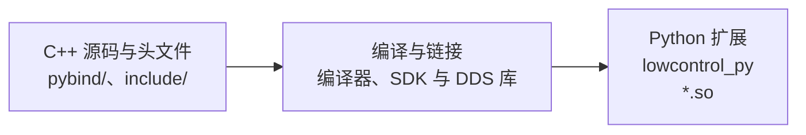
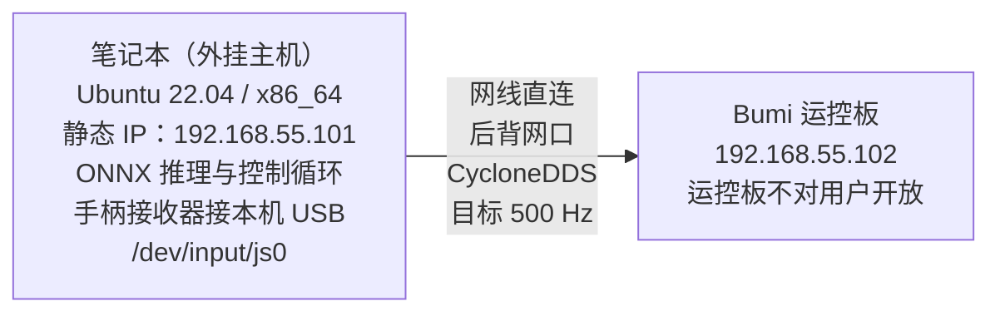
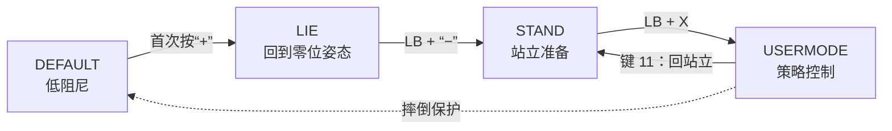

# Bumi 机器人笔记本外挂部署手册

> 作者：祁果 ｜ 仓库：[77-GGG/bumi-handbooks](https://github.com/77-GGG/bumi-handbooks) ｜ PDF 版：[bumi-deploy-handbook.pdf](../bumi-deploy-handbook.pdf)
>
> 本文件由 LaTeX 工程 `deploy-handbook/` 的章节源码逐段转换而成，内容与 PDF（40 页）一致，供全文检索与 AI 阅读使用。

## 目录

- [前言](#前言)
- [第 1 章 终端与 Linux 基础](#第-1-章-终端与-linux-基础)
  - [终端与 Shell](#终端与-shell)
  - [目录与路径](#目录与路径)
  - [命令的基本结构](#命令的基本结构)
  - [文件权限与环境变量](#文件权限与环境变量)
  - [进程与日志](#进程与日志)
- [第 2 章 Python 与 C++ 开发环境](#第-2-章-python-与-c-开发环境)
  - [Python 解释器与模块](#python-解释器与模块)
  - [Python 的基本用法](#python-的基本用法)
  - [Python 与 C++ 的连接](#python-与-c-的连接)
  - [CMake 与工程构建](#cmake-与工程构建)
- [第 3 章 Conda 与虚拟环境](#第-3-章-conda-与虚拟环境)
  - [什么是虚拟环境](#什么是虚拟环境)
  - [安装 Miniconda](#安装-miniconda)
  - [创建与激活环境](#创建与激活环境)
  - [安装 Python 包](#安装-python-包)
  - [在虚拟环境中编译 SDK](#在虚拟环境中编译-sdk)
  - [环境的导出与复现](#环境的导出与复现)
  - [常见问题](#常见问题)
  - [使用 venv](#使用-venv)
- [第 4 章 网络通信与机器人控制](#第-4-章-网络通信与机器人控制)
  - [IP 地址与网络接口](#ip-地址与网络接口)
  - [网络通信与 DDS](#网络通信与-dds)
  - [策略模型与控制指令](#策略模型与控制指令)
  - [控制频率与模式切换](#控制频率与模式切换)
- [第 5 章 外挂开发与系统组成](#第-5-章-外挂开发与系统组成)
- [第 6 章 软件环境的配置](#第-6-章-软件环境的配置)
  - [第 1 步：安装系统与编译环境](#第-1-步安装系统与编译环境)
  - [第 2 步：获取 SDK 与 Python 依赖](#第-2-步获取-sdk-与-python-依赖)
  - [第 3 步：编译 SDK 与 Python 绑定](#第-3-步编译-sdk-与-python-绑定)
- [第 7 章 网络与手柄的配置](#第-7-章-网络与手柄的配置)
  - [第 4 步：配置网线直连](#第-4-步配置网线直连)
  - [第 5 步：验证手柄输入](#第-5-步验证手柄输入)
- [第 8 章 机器人开机与程序启动](#第-8-章-机器人开机与程序启动)
  - [第 6 步：开机与放置机器人](#第-6-步开机与放置机器人)
  - [第 7 步：启动策略程序](#第-7-步启动策略程序)
- [第 9 章 手柄操作与程序退出](#第-9-章-手柄操作与程序退出)
  - [第 8 步：手柄操作与模式切换](#第-8-步手柄操作与模式切换)
  - [第 9 步：停止程序与关机](#第-9-步停止程序与关机)
- [附录 A 手柄按键与控制模式](#附录-a-手柄按键与控制模式)
- [附录 B 使用注意事项](#附录-b-使用注意事项)
- [附录 C 常见故障速查](#附录-c-常见故障速查)

---

# 前言

在笔记本上运行一个 Python 程序，就能让机器人站起来、走起来。这件事听起来很直接，真正动手时，我们却会接连碰到许多问题：命令应该在哪个终端输入？包装到了哪个 Python 里？为什么模型加载成功了，按手柄还是没有反应？

这些问题往往来自一些平时容易忽略的基础概念。因此，本手册先介绍终端、Linux、Python、虚拟环境和网络通信，再把它们放到 Bumi 的部署过程中。我们希望读者既能按步骤完成操作，也能理解每条命令在做什么，遇到问题时知道从哪里查起。

手册分为两部分。第一部分是前置知识，介绍开发中会用到的基本工具与原理；第二部分是部署实践，依次完成环境配置、网络连接、手柄输入、程序启动和运动控制。编译与运行统一使用 Conda 环境 `bumi_deploy`。

初次接触 Linux 和 Python 的读者，建议从第一部分读起。已经熟悉这些工具的读者，可以先看第 3 章中的环境配置，再进入部署实践。每个部署步骤都列出了操作方法、预期结果和常见问题，附录则提供按键和故障速查。

本手册使用 Ubuntu 22.04 `x86_64` 笔记本，通过网线连接 Bumi 后背网口，手柄接收器插在笔记本 USB 口。程序在笔记本上读取手柄、执行 ONNX 推理，并通过 DDS 与运控板交换数据。

调试时请全程使用吊架，按顺序完成模式切换。停止程序前，先通过手柄停控并确认机器人得到稳定支撑。具体操作见部署实践和附录 B。

---

# 第 1 章 终端与 Linux 基础

> **本章导读**
>
> - 分清操作系统、终端、Shell 和运行中的程序。
> - 看懂目录、路径、命令参数、权限与环境变量。
> - 了解常见报错应从哪个层面排查。

很多开发工具都通过终端使用。我们在终端里输入命令，就能安装软件、编译代码和运行程序。刚开始接触时，命令中的路径、参数和符号可能让人摸不着头脑。本章就从这些基本概念讲起，介绍部署 Bumi 时会用到的 Linux 操作。

## 终端与 Shell

Ubuntu 是本手册使用的 Linux 发行版。它提供操作系统内核、桌面、软件仓库和管理工具。终端是输入文字、显示输出的窗口；Shell 是解释命令的程序，本手册的命令采用 Ubuntu 上常见的 Bash 语法。

例如输入 `python examples/py/test_policy.py`，Shell 先查找名为 `python` 的可执行程序，再把后面的脚本路径交给它。随后运行的是 Python 程序；终端继续显示这个程序的输出。

> **概念：选择正确的终端**
>
> 本书的部署命令在 Ubuntu 笔记本的 Bash 终端中执行。Windows PowerShell、CMD、Python 交互窗口和 Bash 对命令的解释各有规则。看到 `>>>` 时，你通常进入了 Python 交互模式；应先输入 `exit()` 返回 Shell，再执行 `conda` 或 `sudo apt` 命令。

这里的部署环境是 Ubuntu，后文的 Conda 也安装在 Ubuntu 中。我们会用到 Linux 版 SDK 和手柄设备节点 `/dev/input/js0`，因此请在 Ubuntu 终端中操作。

## 目录与路径

文件系统把文件组织在目录中。Linux 的路径分隔符是正斜线 `/`，并区分大小写。`policy.onnx` 和 `Policy.onnx` 是两个不同的名字。

| 写法 | 含义与本项目中的例子 |
| --- | --- |
| `/home/alice/noetix_sdk_bumi` | 绝对路径，从文件系统根目录开始；用户名 alice 只是示例。 |
| `~/noetix_sdk_bumi` | Shell 将开头的波浪线展开为当前用户的家目录。 |
| `.` 与 `..` | 当前目录与上一级目录；`./build.sh` 表示运行当前目录的脚本。 |
| `config/dds.xml` | 相对路径，从进程的当前工作目录出发寻找文件。 |
| `/dev/input/js0` | 设备节点的绝对路径，由操作系统提供；它不在 SDK 目录内。 |

下面三个命令分别用于查看位置、列出文件和切换目录：

```bash
pwd
ls
cd ~/noetix_sdk_bumi
```

`pwd` 显示当前目录；`ls` 列出目录内容；`cd` 改变当前 Shell 的目录。这里假设 SDK 保存在家目录下的 `noetix_sdk_bumi` 文件夹中。实际放在其他位置时，把路径换成相应目录即可。

示例程序通过 `os.getcwd()` 获取工作目录，再从中查找配置、模型和 `build/`。因此运行程序时，我们先用 `cd` 进入 SDK 根目录，再执行脚本。这样程序就能按目录结构找到所需文件。

## 命令的基本结构

```bash
sudo apt install -y cmake g++
```

这里 `sudo` 请求以管理员身份执行后面的命令；`apt` 是 Ubuntu 的包管理工具；`install` 是子命令；`-y` 自动确认安装提示；`cmake` 和 `g++` 是要安装的软件包。

`sudo apt update` 更新的是软件包索引，`sudo apt install` 才安装指定软件。输入 sudo 密码时，终端可能不显示字符或星号，这是正常行为。

> **概念：读懂命令中的几个符号**
>
> - 空格分隔参数。路径中包含空格时应加引号，例如 `cd "My Project"`。
> - Bash 代码块中，行末的反斜线表示续行；它后面应直接换行，不要再加空格。
> - `#` 开头的内容通常是注释。教程提示符中的 `$` 和 Python 提示符 `>>>` 不属于要复制的命令。
> - `A && B` 表示 A 成功后才执行 B；`A | B` 把 A 的输出交给 B；`>` 将输出写入文件，并可能覆盖原内容。

## 文件权限与环境变量

`ls -l build.sh` 显示文件权限。若自己获取的脚本没有执行位，可以在 SDK 根目录执行 `chmod u+x build.sh`，再用 `./build.sh` 运行。文件存在、具有执行权限和依赖齐全，是三个不同的条件。

`PATH` 是 Shell 查找可执行程序的目录列表。`command -v python` 显示当前会找到哪个 Python；`export NAME=value` 为当前 Shell 及其之后启动的子进程设置环境变量。每个终端中的 Shell 分别保存这些设置。新开终端后，需要重新执行临时设置的命令。

```bash
command -v python3
echo "$PATH"
ls -l /dev/input/js0
```

手柄节点可能在接收器插入后才出现。出现 `Permission denied` 时，需要检查用户和设备权限；出现 `No such file or directory` 时，应先检查路径与设备枚举。

> **提示：sudo 与 Python 环境**
>
> 安装系统软件时，我们使用 `sudo apt`；在自己的 Conda 环境里安装 Python 包时，直接使用 `python -m pip`。sudo 可能改变程序查找路径，因此运行 SDK 时使用已激活环境中的 Python。手柄的访问权限在第 5 步配置。

## 进程与日志

程序运行时形成进程，日志是它在终端给出的反馈。`Ctrl+C` 通常请求前台程序中断；`Ctrl+Z` 是暂停进程。结束机器人控制程序时，先通过手柄停止控制，再用 `Ctrl+C` 退出。完整流程见第 9 步。

排查一条报错时，先记录完整命令、`pwd`、解释器路径以及最早出现的具体错误，再判断是路径、权限、依赖还是设备问题。编译末尾的 `make: Error` 常常只是失败结果，需要向上找首次失败的原因。

---

# 第 2 章 Python 与 C++ 开发环境

> **本章导读**
>
> - 理解解释器、模块、包和原生扩展之间的关系。
> - 用实际路径定位“已经安装，却仍然无法导入”的原因。
> - 看懂 CMake、编译器、头文件、静态库和共享库的分工。

打开 SDK 目录，你会看到 Python 脚本、C++ 源码、库文件和模型。为什么一个项目里会放这么多种文件？因为它们各有分工：Python 负责组织控制流程，C++ SDK 提供机器人接口，模型文件保存策略。本章介绍这些部分怎样配合工作。

## Python 解释器与模块

`python` 是解释器程序，`test_policy.py` 是交给它执行的脚本。脚本中的 `import numpy` 表示导入模块。一个可安装的软件包可能提供一个或多个模块，安装名与导入名也可能不同，例如安装 `pyyaml`，代码里写的是 `import yaml`。

本例程需要 `numpy` 做数组运算、`yaml` 读取配置、`onnxruntime` 执行模型推理；还需要通过 `lowcontrol_py` 调用 SDK。其中 `lowcontrol_py` 由 SDK 的 C++ 代码编译生成，编译方法见第 3 步。

```bash
python -c "import sys; print(sys.executable); print(sys.version)"
python -m pip --version
python -m pip show numpy
```

第一行确认解释器；第二行确认该解释器使用的 pip；第三行查看包的安装位置。`python -m pip` 的含义是“由这个 Python 执行 pip 模块”，这样安装和运行更容易保持一致。命令用法见[pip 官方用户指南](https://pip.pypa.io/en/stable/user_guide/)。

> **概念：Python 会到哪些地方寻找模块**
>
> Python 按导入搜索路径寻找模块，`sys.path` 可以显示这些路径。示例程序主动加入 SDK 根目录下的 `build/`，让 `import lowcontrol_py` 能找到编译产物。导入失败时，就从解释器路径、模块所在位置和 `sys.path` 这三处检查。

## Python 的基本用法

如果只需要部署，暂时不必通读 Python 语法。先看懂变量、列表、下标和函数调用：

```bash
python -c "axes = [0.2, 0.7]; print(axes[0], axes[1])"
python -c "print(3 + 3 + 2 + 21 + 21 + 21); print(71 * 5)"
```

列表下标从零开始，因此 `axes[1]` 是第二个数。第一行输出两个摇杆示例值；第二行说明程序中观测的维度：3 个运动指令、3 个角速度、2 个姿态角，以及各 21 个关节位置、关节速度和上一帧动作，共 71 个数。堆叠 5 帧后是 355 个输入数。

`if` 根据条件决定执行分支；`while True` 表示持续循环；函数把一组操作组织起来。例如 `process()` 处理当前状态与按键，`load_model()` 读取模型。阅读例程时可以先顺着 `main()` 找调用关系，再进入各函数。

## Python 与 C++ 的连接

本项目使用 pybind11 把 C++ 接口包装成 Python 扩展。过程可以按以下顺序理解：



头文件 `.h`、`.hpp` 声明接口；静态库 `.a` 在链接时参与构建；共享库 `.so` 可以在程序加载或运行时被需要。`lowcontrol_py*.so` 本身也是共享对象，同时具有 Python 扩展入口。

> **提示：扩展模块与 Python 版本**
>
> 扩展模块的文件名通常包含 Python 版本和平台信息。例如 `cpython-310` 表示它面向 CPython 3.10。我们在 `bumi_deploy` 中编译并运行扩展，统一使用 Python 3.10 和 x86_64 库。更换解释器版本时，重新配置 CMake 并编译即可。

## CMake 与工程构建

CMake 读取 `CMakeLists.txt`，查找依赖、选择工具并生成构建规则；G++ 编译 C++；构建工具执行规则并链接产物。`build.sh` 把这些命令写成脚本，便于一次完成配置和编译。编译器和开发库由后文的安装步骤准备。

```bash
cmake -S . -B build
cmake --build build --parallel 8
```

这两行是构建语法示例：`-S .` 指源目录，`-B build` 指构建目录。`--parallel 8` 表示最多使用 8 个并行构建任务。实际部署还需要第 3 步给出的 Python 与依赖参数。参见[CMake 3.22 命令手册](https://cmake.org/cmake/help/v3.22/manual/cmake.1.html)。

`build/CMakeCache.txt` 保存配置结果，包括已经找到的依赖路径。换了 Python 或环境之后，旧缓存可能仍然指向先前的位置；这时需要重新配置，必要时备份并重建构建目录。

> **概念：ONNX Runtime 有两个使用入口**
>
> Python 程序通过 pip 安装的 `onnxruntime` 执行推理；C++ 工程通过 `find_package(onnxruntime REQUIRED)` 查找开发库。两种用法分别对应 Python 包和 C++ 开发配置，我们会在第 2、3 步中分别准备。

---

# 第 3 章 Conda 与虚拟环境

> **本章导读**
>
> - 理解虚拟环境的用途，以及 Conda、Miniconda、pip 与 venv 的区别。
> - 创建并检查 `bumi_deploy` 环境，安装本项目的 Python 依赖。
> - 让 SDK 的编译与运行使用同一个解释器，并保存环境记录。

不同项目经常需要不同的 Python 和第三方库版本。比如 Bumi 使用 Python 3.10，另一个项目使用 Python 3.12；如果把依赖都装在一起，更新一个项目时就可能影响另一个。为了解决这个问题，我们为每个项目创建单独的虚拟环境。

## 什么是虚拟环境

Conda 环境通常是磁盘上的一个目录，里面包含解释器、库和可执行程序。激活环境后，当前 Shell 调整程序查找路径及相关变量，之后输入 `python` 时就能优先使用该环境的解释器。参见[Conda 环境概念](https://docs.conda.io/projects/conda/en/stable/user-guide/concepts/environments.html)与[激活机制说明](https://docs.conda.io/projects/conda/en/stable/dev-guide/deep-dives/activation.html)。

| 名称 | 作用 |
| --- | --- |
| Conda | 包管理与环境管理工具，可管理 Python 和多种原生依赖。 |
| Miniconda | 包含 Conda、基础 Python 等组件的较小安装发行包，按需安装项目依赖。 |
| Anaconda Distribution | 提供更多预装数据科学软件的发行包；运行本例程不要求安装完整套件。 |
| pip | Python 包安装工具。本书通过 `python -m pip` 指向选定解释器。 |
| venv | Python 自带的环境工具，基于已有解释器创建隔离的 Python 包目录。 |

> **提示：环境与工作目录**
>
> 使用项目时，我们做两个操作：通过 `conda activate bumi_deploy` 选择 Python 环境，通过 `cd ~/noetix_sdk_bumi` 进入项目目录。环境负责解释器和软件包，目录决定程序从哪里寻找文件。网卡和手柄则由 Ubuntu 管理，后文会分别配置。

## 安装 Miniconda

本手册选择 Miniconda 作为 Conda 的安装入口。若 Ubuntu 中已经有可用 Conda，先运行 `conda --version`，无需再装一套。下面面向 x86_64 Ubuntu；安装器里的基础 Python 版本不必等于之后项目环境中的 Python 版本。

先下载并检查安装器：

```bash
cd ~
curl -fLO https://repo.anaconda.com/miniconda/Miniconda3-latest-Linux-x86_64.sh
sha256sum Miniconda3-latest-Linux-x86_64.sh
```

将校验结果与[官方安装器目录](https://repo.anaconda.com/miniconda/)中对应文件的 SHA-256 比较，再执行：

```bash
bash Miniconda3-latest-Linux-x86_64.sh
```

按提示阅读条款，使用自己的用户目录作为安装位置，例如 `~/miniconda3`。安装在自己的用户目录中，后续就可以用当前用户管理环境和依赖。流程见[Miniconda 官方 Linux 安装说明](https://www.anaconda.com/docs/getting-started/miniconda/install/linux-install)。

安装结束后关闭并重新打开终端。若 Shell 尚未初始化，在采用上述安装位置时执行：

```bash
~/miniconda3/bin/conda init bash
```

再重新打开终端，并检查：

```bash
conda --version
conda info --envs
```

`conda init bash` 配置的是 Bash 启动时加载 Conda 的方式；不是创建环境。初始化通常只需执行一次；以后每次打开终端，使用 `conda activate bumi_deploy` 进入项目环境。

## 创建与激活环境

本项目使用 Python 3.10。编译与部署统一使用环境名 `bumi_deploy`。创建命令只在环境尚不存在时执行一次：

```bash
conda create -n bumi_deploy python=3.10 pip
conda activate bumi_deploy
python --version
python -c "import sys; print(sys.executable)"
python -m pip --version
conda info --envs
```

`-n bumi_deploy` 指定名字，`python=3.10` 指定 Python 次版本，`pip` 请求一并安装 pip。Conda 在显示安装计划后等待确认；已有同名环境时，应先检查其内容。命令参数见[conda create 官方说明](https://docs.conda.io/projects/conda/en/stable/commands/create.html)。

> **预期结果**
>
> Python 版本为 3.10.x；解释器路径位于 `bumi_deploy` 环境目录中；pip 位置也在该环境内。`conda info --envs` 中当前环境通常以星号标记。激活后，提示符通常显示 `(bumi_deploy)`。

`base` 是 Conda 安装自带的基础环境。本项目使用专门的 `bumi_deploy` 环境，便于单独记录依赖。`conda deactivate` 退出当前激活层；退出后，环境仍保存在磁盘上，下次可以继续激活。

## 安装 Python 包

本手册的主路线是先用 Conda 创建 Python 与 pip，再用当前环境的 pip 安装下面这组 Python 依赖：

```bash
conda activate bumi_deploy
python -m pip install numpy pyyaml onnxruntime pybind11
python -c "import numpy, yaml, onnxruntime, pybind11; print('python deps ok')"
python -m pip check
```

导入命令输出 `python deps ok`，说明这几个包已安装到当前 Python 中；`pip check` 用于检查包之间的依赖关系。示例程序使用 `CPUExecutionProvider` 在 CPU 上推理，安装普通版 ONNX Runtime 即可。

> **提示：Conda 与 pip 的配合**
>
> 我们先用 Conda 安装 Python 和 pip，再用 `python -m pip` 安装项目依赖。这样 pip 会把包装到当前环境中。需要大幅调整依赖时，可以根据环境记录重新创建一个环境。参见[Conda 关于 pip 混用的说明](https://docs.conda.io/projects/conda/en/stable/user-guide/tasks/manage-environments.html#using-pip-in-an-environment)。

接下来还要准备系统和 C++ 依赖：第 1 步通过 APT 安装工具链，第 3 步配置 SDK、DDS 和 ONNX Runtime 开发库。环境、工具链和开发库齐全后，就可以编译 Python 扩展了。

## 在虚拟环境中编译 SDK

SDK 的 Python 扩展要与运行时的解释器对应。因此，我们先激活 `bumi_deploy`，再把这个环境中的 Python 和 pybind11 路径交给 CMake。之后运行程序时，继续使用同一个环境。

完成 SDK 下载和 C++ 依赖安装后，在项目根目录执行下面的命令。第 3 步还会介绍依赖的具体配置方法。

```bash
conda activate bumi_deploy
cd ~/noetix_sdk_bumi
cmake -S . -B build \
  -DPYBIND11_FINDPYTHON=ON \
  "-DPython_EXECUTABLE=$(python -c 'import sys; print(sys.executable)')" \
  "-Dpybind11_DIR=$(python -m pybind11 --cmakedir)"
cmake --build build --parallel 8
```

- `PYBIND11_FINDPYTHON=ON` 选择 pybind11 的 FindPython 支持模式。
- `Python_EXECUTABLE` 指向激活环境实际使用的解释器；它的大小写不能随意改写。
- `pybind11_DIR` 指向该环境中 pybind11 提供的 CMake 配置目录。
- Bash 的 `$(...)` 先执行括号中的命令，再把输出作为参数的一部分。这里的引号保留路径中的空格。

关于这些参数的进一步说明，可以参考[pybind11 FindPython 文档](https://pybind11.readthedocs.io/en/stable/compiling.html#findpython-mode)和[CMake FindPython 文档](https://cmake.org/cmake/help/v3.22/module/FindPython.html)。

> **提示：已有 build 目录时，先核对旧缓存**
>
> 若 `build/` 曾由另一个环境配置，先停止使用相关程序，并在 SDK 根目录将它备份为一个尚未存在的目录，例如 `mv build build-before-conda`，再重新配置。新的产物仍放在 `build/`，以匹配例程固定加入的导入路径。构建目录统一命名为 `build/`。

配置阶段若报缺 ONNX Runtime，先按第 3 步处理开发包。配置成功后，再构建并从 SDK 根目录验证：

```bash
python -c "import sys; sys.path.insert(0, './build'); import lowcontrol_py; print(sys.executable); print(lowcontrol_py.__file__)"
```

验证通过后，每次运行仍需完成两件事：激活 `bumi_deploy`，进入 SDK 根目录。也可用 `conda run` 配合 `-n bumi_deploy` 明确指定环境；运行前仍需进入 SDK 根目录。

## 环境的导出与复现

环境配置好以后，我们通常希望把它保存下来，方便换电脑、与同伴协作或以后重新安装。这时就需要一份环境清单，记录 Python 和各个包的版本。

先看一个简单例子。把下面的内容保存为 `environment.yml`：

```yaml
name: bumi_deploy
dependencies:
  - python=3.10
  - pip
  - pip:
      - numpy
      - pyyaml
      - onnxruntime
      - pybind11
```

在另一个环境尚不存在的目标机器上，可以用 `conda env create -f environment.yml` 创建。这份清单指定 Python 3.10，其余包由安装时解析版本。要保存当前环境的具体版本，可以使用下面的导出命令。

工作环境验证通过后，保存实际记录：

```bash
conda env export --no-builds > environment-tested.yml
python -m pip freeze > requirements-tested.txt
conda list > conda-packages-tested.txt
```

分享 YAML 前检查并移除可能出现的本机 `prefix:` 路径。`requirements-tested.txt` 记录 Python 包的版本。与环境清单一起保存的，还应有 Ubuntu 版本、CPU 架构、SDK 版本、编译参数和模型版本，便于在另一台机器上复现。

`--from-history` 用于导出手动指定的 Conda 依赖。这里同时使用了 pip，因此我们保存完整环境清单，并额外用 `pip freeze` 记录 Python 包。迁移到相同系统和架构后，再编译 SDK 扩展。有关选项见[Conda 环境导出说明](https://docs.conda.io/projects/conda/en/stable/commands/env/export.html)；它与新版本提供的 `conda export` 命令可以按版本选用。

## 常见问题

> **常见问题：conda: command not found，或者提示先运行 conda init**
>
> 先检查 Miniconda 是否安装在当前 Ubuntu 用户下。若位于 `~/miniconda3`，用其绝对路径执行 `conda init bash` 后重开终端。这里检查的是 Ubuntu 中的安装位置。

> **常见问题：显示 (bumi_deploy)，却仍然找不到刚安装的包**
>
> 比较 `python -c "import sys; print(sys.executable)"` 与 `python -m pip --version`。还要检查是否用了 `/usr/bin/python3`、sudo、另一个终端或编辑器的其他解释器。把运行命令和编辑器都切换到 `bumi_deploy` 中的解释器即可。

> **常见问题：能导入 numpy，仍不能导入 lowcontrol_py**
>
> 先确认在 SDK 根目录，且 `build/` 内确有对应扩展；再核对构建使用的 Python。`ModuleNotFoundError` 侧重检查模块搜索路径；提示缺少共享库的 `ImportError` 则侧重检查原生依赖。

> **常见问题：导入时报 libstdc++、GLIBCXX 或其他共享库错误**
>
> 这属于原生库加载问题。可用 `ldd build/lowcontrol_py*.so` 查看依赖路径和 `not found`，并比较是否意外混用了 Conda 与系统库。根据输出找到缺失的库，再安装对应依赖，或修正构建时选择的库路径。

> **常见问题：环境依赖解析失败，或者下载超时**
>
> 保留完整错误，区分版本约束冲突与网络连接失败。先查看 `conda config --show channels` 和网络状况；使用机构镜像时，按镜像文档设置渠道，并把来源保存在环境记录中。

> **常见问题：换电脑后能否直接复制整个 Conda 环境文件夹**
>
> 在目标机器上用环境清单创建环境，再重新编译 SDK 扩展。这样可以按目标机器重新配置绝对路径和二进制依赖。源代码、配置、ONNX 模型和环境清单分别保存。

## 使用 venv

如果只想沿用系统 Python 并隔离 Python 包，可选择 Python 自带的 venv。参见[Python venv 文档](https://docs.python.org/3.10/library/venv.html)。使用前先退出 Conda 环境，再创建并激活 venv：

```bash
sudo apt install python3-venv
cd ~/noetix_sdk_bumi
python3 -m venv .venv
source .venv/bin/activate
python -m pip install numpy pyyaml onnxruntime pybind11
```

之后同样将当前 `python` 传给 CMake，并在运行时激活同一个 venv。后面的部署步骤使用 Conda 的 `bumi_deploy` 环境。若选用 venv，把激活命令换成 `source .venv/bin/activate` 即可。

---

# 第 4 章 网络通信与机器人控制

> **本章导读**
>
> - 分清 IP、网卡、子网、路由与端口的职责。
> - 了解 ping、DDS 和手柄输入的检查方法。
> - 用示例程序认识观测、策略、动作和控制模式。

机器人控制程序需要同时处理网络、手柄和模型。网络传输机器人的状态和指令，手柄提供运动输入，模型则根据观测计算动作。本章介绍这几部分怎样连接起来，以及怎样检查它们的工作情况。

## IP 地址与网络接口

一台笔记本可以同时有 Wi-Fi 和有线网卡。IP 配置附着在具体接口上，因此先用 `ip -br addr` 找实际有线网卡名，再把指定地址配置到它上面。手册中的 `enp3s0` 只是例子。

`192.168.55.101/24` 表示这个 IPv4 地址带有 24 位网络前缀，对应掩码 `255.255.255.0`。本部署中，笔记本的 `.101` 和运控板的 `.102` 位于同一 `192.168.55.0/24` 子网；两个设备不能同时占用同一个地址。

```bash
ip -br addr
ip route get 192.168.55.102
```

第二条显示内核为目标地址选择的路由、网络接口和源地址。配置完成后，应看到流量走实际有线网卡，源地址为 `192.168.55.101`。

> **概念：网关、DNS 与本机直连**
>
> 默认网关用于没有更具体路由时转发流量；DNS 把域名解析成 IP。直接访问同子网的数字 IP 通常不需要 DNS，也不需要给机器人直连网卡配置默认网关。下载依赖所需的互联网连接，与机器人有线子网可以分别检查。

## 网络通信与 DDS

`ping` 向目标发送 ICMP 请求，并显示响应时间与丢包情况。配置好 IP 后，我们先用它检查连通性，再检查 DDS 的硬件状态回调。

DDS 配置文件选择 UDP、关闭组播，并把运控板地址作为静态 Peer。DDS 负责程序间数据交换；IP 指定主机，端口用于区分传输端点。DDS 的通信参数保存在 `config/dds.xml` 中，排查时可以先检查这个文件。

| 观察到的结果 | 检查内容 |
| --- | --- |
| 能下载 Python 包 | 用于下载依赖的互联网连接正常。 |
| `ping` 有回复 | ICMP 可达；还需检查 DDS 配置、接口选择和硬件状态回调。 |
| `jstest` 数值变化 | 接收器和本机输入设备已有数据。 |
| 模型加载成功日志 | ONNX 模型相关初始化已进行；还需验证硬件状态和手柄。 |

在 `process()` 中，`latest_hw_status is None` 或手柄数据为 `None` 都会让函数提前返回。所以“程序还在跑，按键却没反应”时，应分别定位网络状态与本机输入。

## 策略模型与控制指令

策略是把观测映射为动作的函数；ONNX 是本项目保存模型的一种格式，ONNX Runtime 负责执行它。部署是加载已有策略并进行推理；训练则是产生或更新策略参数的过程。本指南处理前者。

示例程序把运动指令、IMU 与关节状态、上一帧动作组成观测；模型给出 21 维动作。动作再经缩放，与默认关节位置组合成目标位置：

$$
q_i^{des} = q_i^{default} + s_i a_i .
$$

其中 $a_i$ 是模型输出，$s_i$ 是对应关节的动作比例。程序根据这个公式生成目标位置，并把位置、刚度、阻尼等参数一起提交给 SDK。

> **提示：更换策略模型**
>
> 第一次部署使用 SDK 配套的模型与配置。以后更换模型时，需要逐项对应 21 维动作、71×5 维观测、关节顺序、默认角度、动作比例和控制增益。示例程序使用固定关节列表，因此模型的关节排列也要与它一致。

## 控制频率与模式切换

主循环目标周期为 0.002 s，即名义 500 Hz；在正常策略循环中，每 10 次更新一次模型动作，对应名义 50 Hz。两次策略更新之间，程序继续向 SDK 提交相应关节指令。这是“控制频率”与“策略更新频率”的区别。

$$
f_{policy} ≈ f_{loop} / decimation = 500 / 10 = 50 Hz .
$$

实际周期还受到程序耗时和系统调度的影响。打印大量日志、设备读写阻塞或后台任务较多时，循环周期会变长。因此运行前要接通电源、开启性能模式，并减少后台负载。

阻尼、零位插值、站立准备和策略控制，是程序组织控制行为的不同模式。后文第 8 步介绍如何通过手柄依次切换这些模式。

---

# 第 5 章 外挂开发与系统组成

> **本章导读**
>
> - 理解笔记本、手柄和运控板各自的职责。
> - 核对固定 IP、模型文件、控制周期与运行平台。

部署前先回答三个问题：策略在哪里运行，手柄接在哪里，指令通过什么链路送给机器人。外挂开发中，这三个问题都围绕笔记本展开。



外挂部署中的主机、通信链路与运控板。策略名义推理频率为 50 Hz。

| 项目 | 值 | 说明 |
| --- | --- | --- |
| 运控板 IP | `192.168.55.102` | `config/dds.xml` 中 Peer 指向它 |
| 笔记本必须配置的静态 IP | `192.168.55.101` | 运控板**只允许**与原版算力板的固定 IP 通信，外挂设备需伪装成原算力板 |
| 原算力板账号 | `noetix / bumi` | 若你的 Bumi 自带算力板且在开机，会与笔记本 IP 冲突，需先关闭算力板 |
| 通信中间件 | CycloneDDS 0.11.0，禁用组播，Peer 静态指定 | 配置文件 `config/dds.xml` |
| 控制频率 | 目标 500Hz（2ms 控制环），策略名义推理 50Hz（decimation=10） | `test_policy.py` 主循环 + `bumi_ac.yaml` |
| 策略文件 | `policy/policy.onnx`（21 自由度跑步策略） | 模型参数读取 `config/bumi_ac.yaml` 的 `run:` 段 |
| 手柄 | 澳加狮手柄，接收器插**笔记本** USB，设备节点 `/dev/input/js0` | 运控板接口插不了接收器，手柄数据必须从运行程序的机器直接读取 |

> **提示：运行平台**
>
> SDK 使用 Linux 库和设备接口。本手册选择 Ubuntu 22.04 x86_64，网卡直接连接机器人，手柄接收器直接连接笔记本。Windows 用户可安装 Ubuntu 双系统，在 Ubuntu 中完成部署。

> **提示：调试支撑**
>
> **调试全程使用机器人吊架**，并在切换控制模式前确认机器人得到稳定支撑。

---

# 第 6 章 软件环境的配置

> **本章导读**
>
> - 完成第 1 至第 3 步：安装系统与依赖、获取 SDK、编译 Python 绑定。
> - 区分 Python 推理包、C++ 开发包与 SDK 自带库。

这一章完成软件环境的准备。我们先安装工具链和 Python 依赖，再编译 SDK 的 Python 扩展。最后分别导入 ONNX Runtime 和 `lowcontrol_py`，检查推理模块和机器人接口。

## 第 1 步：安装系统与编译环境

首先安装 Ubuntu 22.04 x86_64 和编译工具链，让系统与 SDK 中提供的库保持一致。

### 操作步骤

1. 笔记本安装 Ubuntu 22.04 LTS（x86_64），接通电源、关闭休眠。
2. 安装编译依赖：

```bash
sudo apt update
sudo apt install -y cmake g++ build-essential libyaml-cpp-dev libeigen3-dev \
    libboost-all-dev libfmt-dev python3-dev python3-pip git curl
```

3. 若 `cmake --version` 低于 3.16（22.04 默认 3.22 一般够用），按手册装 cmake 3.26.3：解压后 `sudo mv cmake-3.26.3-Linux-x86_64 /opt/`，再 `sudo ln -s /opt/cmake-3.26.3-Linux-x86_64/bin/* /usr/bin/`。

> **预期结果**
>
> - `cmake --version` ≥ 3.16；`g++ --version` ≈ 11.4；Ubuntu 的系统 `python3 --version` 为 3.10.x；项目使用的解释器在第 2 步单独确认。
> - 编译 SDK 不需要 ROS 环境。

### 常见问题

> **常见问题：apt 安装包 404 / 锁定**
>
> 先 `sudo apt update`；有进程占用时等几秒重试。

> **常见问题：cmake 版本过低，编译报 `CMake 3.16 required`**
>
> 按上面方法手动安装 cmake 3.26.3。

> **常见问题：只有 Windows 系统**
>
> 为笔记本安装 Ubuntu 双系统，在 Ubuntu 中使用 SDK。项目提供的 x86_64 库和手柄节点 `/dev/input/js0` 都对应 Linux 环境。

## 第 2 步：获取 SDK 与 Python 依赖

SDK 的目录结构本身也是运行条件。例程从当前工作目录定位 build、config 与 policy，复制文件时要保留整套目录。

### 操作步骤

1. 在笔记本上获取 SDK（二选一）：

```bash
git clone https://github.com/Noetix-Robotics/noetix_sdk_bumi.git
# 或把本目录（含 build.sh、config、dds、examples、lib、policy、pybind）整体拷到笔记本，如 ~/noetix_sdk_bumi
```

2. 按第 3 章安装 Miniconda；若尚无 bumi_deploy 环境，先创建，再激活并安装 Python 依赖：

```bash
# 仅在 bumi_deploy 环境尚不存在时执行 create
conda create -n bumi_deploy python=3.10 pip
conda activate bumi_deploy
python -m pip install onnxruntime numpy pyyaml pybind11
python -c "import sys; print(sys.executable)"
```

3. 确认关键文件存在：`policy/policy.onnx`、`config/bumi_ac.yaml`（须含 `run:` 段）、`config/dds.xml`。

> **预期结果**
>
> - `python -c "import onnxruntime, numpy, yaml; print('ok')"` 输出 `ok`。
> - SDK 目录结构完整（build.sh / config / dds / examples / lib / policy / pybind）。

### 常见问题

> **常见问题：pip 安装时出现权限或 externally-managed 报错**
>
> 激活 `bumi_deploy`，再用 `python -m pip --version` 检查 pip 路径，然后重新安装。环境配置见第 3 章。使用 venv 时，激活对应的 venv 即可。

> **常见问题：换用自己的策略模型时缺 `policy/policy.onnx`**
>
> test_policy.py 固定加载 `<cwd>/policy/policy.onnx`，文件名/路径不能变；模型需内嵌 `joint_names / joint_stiffness / joint_damping / default_joint_pos / action_scale` 元数据，且与 `bumi_ac.yaml` 的 `run:` 段尺寸参数一致（actions_size=21、observations_size=71、stack_size=5）。

> **常见问题：显卡（GPU）用不上？**
>
> 正常现象：本例程 onnxruntime 显式使用 `CPUExecutionProvider`，模型很小 CPU 足够。想用 GPU 装的是 `onnxruntime-gpu`，并把 `load_model()` 中 providers 改为 `["CUDAExecutionProvider","CPUExecutionProvider"]`；注意 GPU 首帧初始化/调度抖动可能影响 500Hz 实时性，实机前先用吊架验证。

## 第 3 步：编译 SDK 与 Python 绑定

这一步把 C++ 接口编译成 Python 扩展。除了前面安装的 Python 包，CMake 还需要 ONNX Runtime 的 C++ 开发配置。

### 操作步骤

1. 激活与运行相同的 Conda 环境，进入 SDK 根目录。若曾用其他 Python 构建，先按第 3 章「在虚拟环境中编译 SDK」一节备份旧 build 目录。
2. 明确指定当前 Python 和 pybind11 的 CMake 路径，再进行配置与构建：

```bash
conda activate bumi_deploy
cd ~/noetix_sdk_bumi
cmake -S . -B build \
  -DPYBIND11_FINDPYTHON=ON \
  "-DPython_EXECUTABLE=$(python -c 'import sys; print(sys.executable)')" \
  "-Dpybind11_DIR=$(python -m pybind11 --cmakedir)"
cmake --build build --parallel 8
```

> **提示：与原 build.sh 的关系**
>
> 原脚本在 build 目录运行 CMake 与 make。这里手动展开构建，并增加解释器选择参数，保持产物仍位于 build；无需修改 SDK 源码。后续若继续使用脚本，也要先激活同一环境并核对缓存。

3. 如果配置阶段报告缺少 ONNX Runtime，先准备 SDK 所要求的 C++ 开发包，并确认其中存在 CMake 可发现的 `onnxruntimeConfig.cmake` 或 `onnxruntime-config.cmake`。CMake 通过配置文件定位头文件、库和相应构建设置。
4. 找到上述文件后，把它**所在的目录**作为 `-Donnxruntime_DIR=...` 参数追加到同一次 CMake 配置命令；或按开发包文档设置 `CMAKE_PREFIX_PATH`。保留上面的 Python 与 pybind11 参数。若发行包中缺少此配置，按 SDK 开发环境要求补齐相应开发安装。

ONNX Runtime 下载文件选择 Linux x86_64，安装路径按实际目录填写。

> **预期结果**
>
> - 编译无报错；`build/` 目录生成 `lowcontrol_py*.so`（还有 `highcontrol_py*.so`、`mediacontrol_py*.so`）。
> - `build/` 目录生成 `example_low`、`example_high`、`example_policy`、`example_media` 可执行文件。
> - 从 SDK 根目录用当前 `python` 验证导入，解释器来自 bumi_deploy 环境，扩展来自 SDK 的 build 目录：

```bash
python -c "import sys; sys.path.insert(0, './build'); import lowcontrol_py; print(sys.executable); print(lowcontrol_py.__file__)"
```

### 常见问题

> **常见问题：运行时报 `error while loading shared libraries: libssl.so.1.1`**
>
> Ubuntu 22.04 缺少 libssl1.1 时，从手册下载对应架构 deb 并安装（x86_64）：`sudo dpkg -i libssl1.1_1.1.1f-1ubuntu2_amd64.deb`。

> **常见问题：`find_package(onnxruntime REQUIRED)` 失败**
>
> 检查开发包是否实际提供 CMake 包配置文件，再按本步骤设置 `onnxruntime_DIR` 或开发安装前缀。配置文件所在目录要与 CMake 参数对应。

> **常见问题：链接/编译报与 gcc 相关错误**
>
> 手册要求 gcc 11.4（22.04 默认即 11.4），勿混用其他版本工具链。

> **常见问题：找不到 `libnoetix_sdk.a` / DDS 库**
>
> 仓库不完整：`lib/x86_64/` 与 `dds/x86_64/` 必须存在；架构要匹配（笔记本用 x86_64，不要用 aarch64 的 docker 镜像 noetix_dds——该镜像仅限 arm64）。

---

# 第 7 章 网络与手柄的配置

> **本章导读**
> - 完成第 4、5 步：配置固定地址并检查手柄输入。
> - 分别验证 DDS 所依赖的有线链路和本机 USB 输入链路。

网络和手柄是两条独立链路。网络负责机器人状态与控制指令，USB 接收器负责操作输入。任意一条没有数据，程序都有可能保持运行却不响应按键。

## 第 4 步：配置网线直连

外挂笔记本使用原算力板的固定地址。先排除地址冲突，再检查到运控板的连通性；ping 成功仍需继续验证 DDS 是否收到硬件状态。

### 操作步骤

1. 网线一端插笔记本有线网口，另一端插 **Bumi 后背的网口**（即原算力板接口；运控板通过内部交换机走有线）。
2. 给笔记本有线网卡配静态 IP（示例网卡名 `enp3s0`，用 `ip addr` 查实际名称）：

```bash
sudo ip addr add 192.168.55.101/24 dev enp3s0
sudo ip link set enp3s0 up
```

（永久生效可用 nmcli/netplan 配置，地址 192.168.55.101/24，不配网关。）

3. 机器人开机后（见第 6 步）测试连通：

```bash
ping 192.168.55.102
```

> **预期结果**
> - `ping 192.168.55.102` 有回复，丢包率低。
> - `config/dds.xml` 无需修改：其 Peer 已指向 `192.168.55.102`。

### 常见问题

> **常见问题：ping 不通**
> （1） 笔记本 IP 不是 192.168.55.101（运控板只认这个 IP）；（2） 网线没插到 Bumi 后背正确网口；（3） 机器人未开机/运控程序未启动完；（4） 笔记本其他网卡（WiFi）路由抢占了 192.168.55.0 网段，可临时关 WiFi 或加明细路由。

> **常见问题：IP 冲突提示**
> 你的 Bumi 若自带算力板且在运行，它已占用 192.168.55.101。外挂方式下笔记本要"顶替"算力板：先让算力板下电/关闭，或直接改为在算力板上跑（`ssh noetix@192.168.55.101`，密码 bumi）。

> **常见问题：DHCP 自动获取了别的地址**
> Bumi 侧没有 DHCP 服务，必须手工配静态 IP。

> **常见问题：NetworkManager 反复改写 IP**
> 用 nmcli 建一个 manual/静态连接配置，避免每次插拔变化。

## 第 5 步：验证手柄输入

示例程序通过笔记本上的 `/dev/input/js0` 读取手柄。把 USB 接收器插到笔记本，再检查设备节点和输入数据。

### 操作步骤

1. 把**澳加狮手柄的 USB 接收器**插到笔记本 USB 口，打开手柄电源并配对。
2. 验证设备节点与数据：

```bash
ls -l /dev/input/js0
sudo apt install -y joystick        # 提供 jstest 工具
jstest /dev/input/js0               # 摇动摇杆/按键，观察数值变化
```

> **预期结果**
> - `/dev/input/js0` 存在；jstest 中轴的原始整数读数随摇杆变化，按键位翻转；程序使用的归一化轴值与 jstest 的原始读数应区分。
> - test_policy.py 初始化即调用 `aoliondriver.init("/dev/input/js0", 115200)`，读取的正是这个节点。

### 常见问题

> **常见问题：没有 `/dev/input/js0`**
> 先把接收器插到笔记本并打开手柄完成配对。再用 `lsusb` 检查设备枚举，必要时更换 USB 口。

> **常见问题：普通 Python 进程打不开设备（权限）**
> 确认设备权限后，按需执行 `sudo usermod -aG input $USER` 并重新登录，再激活 bumi_deploy。重新登录后，使用该用户和已激活环境中的 Python 运行程序。

> **常见问题：jstest 有数据但程序里 `getremotedata()` 一直为 None**
> 设备不是标准 joystick 协议或节点不是 js0（多手柄/模拟器会变成 js1），确认 `/dev/input/` 下唯一手柄节点；代码写死 `js0`，必要时改 `init()` 第一个参数。

---

# 第 8 章 机器人开机与程序启动

> **本章导读**
> - 完成第 6、7 步：准备机器人、开机、从正确目录启动例程。
> - 结合终端日志、网络与手柄数据判断启动是否完成。

软件环境准备好后，就可以开机并启动程序了。先把机器人放置在吊架上，完成开机和回零；再从 SDK 根目录启动程序，观察模型加载、硬件状态和手柄输入。

## 第 6 步：开机与放置机器人

开机时让机器人面朝上平躺，或在吊架上保持稳定姿态。程序中的零位姿态称为 `LIE`，后面会用手柄从这个模式进入站立。

### 操作步骤

1. 吊架安装/平整防滑地面，清出约 3m×3m 无杂物区域。
2. 电池插入后背电池仓，确认卡扣锁定。
3. 短按一次电池开关，确认电池指示灯亮起；随后**长按电池开关直至出现流水灯效果**，等待完成开机。
4. 开机后 Bumi 自动进入**全身使能模式**，所有关节自动回零位——过程中**不要触碰、阻挡关节**；也不要把关节卡在限位位置开机（有烧机风险）。
5. 让机器人保持仰卧（面朝上平躺）或吊挂姿态，等待程序控制。

> **预期结果**
> - 机器人开机完成，关节自动回零，处于使能趴卧状态，网络可达（第 4 步 ping 通）。

### 常见问题

> **常见问题：开机时关节被地面/杂物卡住、异响**
> 立即长按电池开关关机检查；开机姿势务必面朝上平躺、四肢自然摆放，脚底无异物。

> **常见问题：关节回零时机器人被拽动**
> 全身使能回零过程请勿干预，否则初始化失败需重启。

> **常见问题：电池电量低/告警**
> 低电量会导致运控异常甚至失控，先充满电再跑策略；程序里也可从 `bms_data.battery_soc` 读取电量。

## 第 7 步：启动策略程序

工作目录决定相对路径能否解析。始终在 SDK 根目录启动；模型加载成功后，再结合硬件状态与手柄输入判断控制链路是否完整。

### 操作步骤

1. **必须从 SDK 根目录启动**（程序用相对路径找 `build/`、`config/dds.xml`、`policy/`）：

```bash
conda activate bumi_deploy
cd ~/noetix_sdk_bumi
python -c "import sys; print(sys.executable)"
python examples/py/test_policy.py
```

2. 保持终端在前台运行，不要让笔记本休眠/降频（建议插电源、设置 Performance 电源模式）。

> **预期结果**
> （终端依次打印）
>
> ```bash
> cur path is file:///home/<用户>/noetix_sdk_bumi/config/dds.xml
> Load Onnx model from path: /home/<用户>/noetix_sdk_bumi/policy/policy.onnx
> Load Onnx run model successfully !!!
> ```
>
> - 程序常驻运行（目标 500Hz 主循环），初始模式为 DEFAULT，等待手柄指令。该模式下发低阻尼指令，机器人由吊架支撑。
> - 模式切换时会打印日志；策略模式会打印观测数值（见第 8 步）。当前代码未在正常策略循环中复位 `isChangeMode_`，因此观测打印可能重复出现。

### 常见问题

> **常见问题：`ModuleNotFoundError: lowcontrol_py`**
> 检查是否已激活构建时的 bumi_deploy 环境、是否在 SDK 根目录、build 内是否有对应扩展。参见第 3 步和第 3 章「在虚拟环境中编译 SDK」一节；若变更过 Python，应重新配置并编译。

> **常见问题：`FileNotFoundError: config/dds.xml` 或 CYCLONEDDS 连不上**
> 同上，工作目录不对；确认 `CYCLONEDDS_URI` 打印为 `file://<SDK_ROOT>/config/dds.xml`。

> **常见问题：onnx 加载失败 / `policy_session is None`**
> `policy/policy.onnx` 缺失或损坏；当前环境未安装 ONNX Runtime；用 `python -m pip show onnxruntime` 检查。

> **常见问题：yaml 报 KeyError `run`**
> `config/bumi_ac.yaml` 缺 `run:` 段或文件被改动。

> **常见问题：程序在跑、打印正常，但按手柄机器人无反应**
> 两类断点：（1） DDS 没连上运控板（硬件状态回调没数据，回第 4 步查网络）；（2） 手柄没数据（`getremotedata()` 返回 None，回第 5 步 jstest 验证）。

> **常见问题：控制卡顿/机器人抖动**
> 笔记本节能降频或后台负载高：插电源、性能模式、关闭占 CPU 的程序；500Hz 实时性优先。

---

# 第 9 章 手柄操作与程序退出

> **本章导读**
> - 完成第 8、9 步：逐级切换模式、使用摇杆并停止控制。
> - 识别模式日志、摔倒保护和退出时的控制状态。

按键改变的是程序状态，而每种状态采用不同的控制方法。先分清阻尼、零位插值、站立准备和策略控制，再操作按键；每次切换后都等待机器人和终端日志给出反馈。

## 第 8 步：手柄操作与模式切换

下面的顺序对应推荐操作路径。LB+− 当前分支未完整实现按键锁存，点按后松开第二个键，再等待站立插值完成，避免长按反复重置过程。

手柄按键与 button 索引对照（手册）：RB=1，**LB=2**，**X=5**，Y=6，B=7，A=8，**"+"=9**，**"−"=10**，无标名键=11，左摇杆按下=12。

程序内模式：`DEFAULT`（阻尼）→ `LIE`（趴卧回零）→ `STAND`（站立准备）→ `USERMODE`（策略行走），逐级切换：

1. **按 "+" 一次**。开始控制：从当前姿态缓慢插值到趴卧零位。 **观察反馈：** 终端打印 `start control`，机器人关节缓慢回零趴下
2. **LB + "−" 同时按**。趴卧 → 站立准备模式（四肢微曲站立，约 2 秒插值）。 **观察反馈：** 终端打印 `STAND2LIE`（示例代码打印文案有误，实际是**进入 STAND 站立**），机器人自起立站稳
3. **LB + X 同时按**。站立 → **策略控制行走模式**（ONNX 策略接管 21 关节）。 **观察反馈：** 终端打印 `TO USERWALK MODE`，随后打印一屏观测数值（71×5 个数）；机器人姿态由策略维持
4. **摇杆**。控制运动：**axes[1]（左摇杆前后）= 前进/后退，axes[0] = 左右转向**。 **观察反馈：** 前进最大约 0.5 m/s（scalex=0.5），仅当前进指令满足 0≤cmd_x<0.3 时置零，对应正向推程约小于 60%；负向指令没有这一死区；转向 yaw 的绝对值≤1.0、死区 0.3
5. **无标名键(11)**。行走 → 回站立。 **观察反馈：** 终端打印 `WALK2STAND`，策略退出、保持站立
6. **再按 "+"**。停止控制，回到阻尼模式。 **观察反馈：** 终端打印 `stop control`，全身关节失力进入阻尼。示例代码设置 kp=0、kd=0.1、tau=0，不主动驱动关节回零

> **提示：站立模式的日志**
> 示例程序进入 `STAND` 时打印 `STAND2LIE`。这里的打印名称与状态转换方向相反，实际动作是进入站立准备模式。

### 常见问题

> **常见问题：按 "+" 无反应**
> 手柄数据没到程序（jstest 验证、检查接收器）；或程序还没收到硬件状态（DDS 未连通，回第 4/7 步）。

> **常见问题：组合键（LB+−、LB+X）不生效**
> 先按住 LB，再点按第二个键后松开；等待动作完成后再切换。代码检查 `button[2]==1` 与另一键同时成立；当前 LB+− 分支未置位 `keyflag[10]`，长按可能反复重置站立插值。

> **常见问题：站立过程晃动/失败**
> 地面不平/打滑、吊架吊带别太松；确保站立插值过程没有外物阻挡。

> **常见问题：终端突然打印 `Fall Protection Triggered (UserMode)!` 并全身变软**
> 策略摔倒保护：机器人倾角超限（projectedGravity 判定），自动回 DEFAULT 阻尼。恢复流程：扶正机器人 → 按 "+"（打印 `stop control`）→ 再按 "+"（`start control`）→ LB+"−" 站立 → LB+X 重新进策略。

> **常见问题：行走中猛冲/失控**
> 立刻按无标名键(11)回站立或按 "+" 进阻尼；首次测试务必用吊架并小幅推杆。

> **常见问题：把机器人拎起来后关节仍持续输出**
> 手册禁止：行走步态下勿将机器人拎起双脚悬空（电机异常受力损坏风险）；先按键停止再搬运。

## 第 9 步：停止程序与关机

退出顺序从机器人控制状态开始：先确认支撑和停控，再结束进程。需要使用 APP 收纳时，应先退出 SDK 程序，再切换到 APP，保持单一控制源。

### 操作步骤

1. 先按 **"+"** 让机器人 `stop control`（进阻尼、关节失力），**再** `Ctrl+C` 退出程序（避免在策略输出中直接断开）。
2. 关机（手册）：APP 执行一键收纳 → 扶稳机器人坐于地面 → 长按电池开关直至完全关机 → 按卡扣取出电池充电。

> **预期结果**
> - 终端进程退出；直接使用 Ctrl+C 时可能显示 KeyboardInterrupt。应先确认 stop control 与机器人支撑状态，再退出和搬运。

### 常见问题

> **常见问题：直接 Ctrl+C 后机器人保持最后一个力矩指令短暂僵硬**
> 先保持机器人得到支撑，按“+”并确认终端打印 `stop control`，再按 `Ctrl+C` 退出程序。

> **常见问题：一键收纳失败**
> 周围 3m×3m 有杂物、地面打滑；先清理再重试（手册禁止杂物环境使用收纳/起身）。

---

# 附录 A 手柄按键与控制模式



> **提示：“+”切换的是 startcontrol 标志**
>
> 正常接管后再按“+”，终端应打印 `stop control` 并进入 DEFAULT。
> 摔倒保护将模式切回 DEFAULT，但不会清除 `startcontrol`，因此恢复时先按“+”停控，再按“+”重新接管。

- **摇杆**：`axes[1]` 控制前进和后退；`axes[0]` 控制转向。名义前后向指令范围约为 `[-0.5, 0.5]` m/s。正向 `0 ≤ v_x < 0.3` 时置零，负向没有同样的死区；转向指令绝对值不超过 `1.0`，死区为 `0.3`。
- **日志**：`TO USERWALK MODE` 表示进入策略模式；`WALK2STAND` 表示退出策略；`Fall Protection Triggered (UserMode)!` 表示触发摔倒保护。

---

# 附录 B 使用注意事项

调试和使用机器人时，请注意以下事项。

1. 调试**全程使用吊架**，防止程序错误导致失控损坏。
2. 开机时关节勿处限位、勿阻挡回零；面朝上平躺、地面平坦防滑、脚底无异物。
3. 起身/收纳动作波及范围 3m×3m 内不得有杂物；禁止运动中人为干扰（策略为盲走）。
4. 禁止快速反复切换模式；禁止行走时拎起机器人双脚悬空。
5. 电池未正确安装禁止开机；低电量勿跑策略。
6. 同一时间只允许一个控制源（APP/手柄直连/本 SDK 程序不要同时控制）。

---

# 附录 C 常见故障速查

| 现象 | 首查 | 次查 |
| --- | --- | --- |
| 编译失败 | cmake/gcc 版本、onnxruntime 包 | `./build.sh clean` 后重编 |
| import 失败 | 是否在 SDK 根目录、build/*.so 是否存在 | 第 3 步 |
| 程序正常但机器人无反应 | `ping 192.168.55.102`、笔记本 IP 是否 192.168.55.101 | jstest 手柄、DDS 配置 |
| libssl.so.1.1 报错 | 装手册提供的 x86_64 deb | 第 3 步 FAQ |
| 机器人软掉/Fall Protection | 扶正后按恢复流程 | 第 8 步 FAQ |
| 运动卡顿 | 电源模式/后台负载/网卡丢包（`ping -f` 简单压测） | 换更短网线、固定网卡 |
