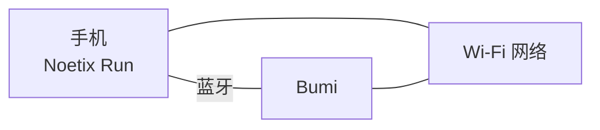
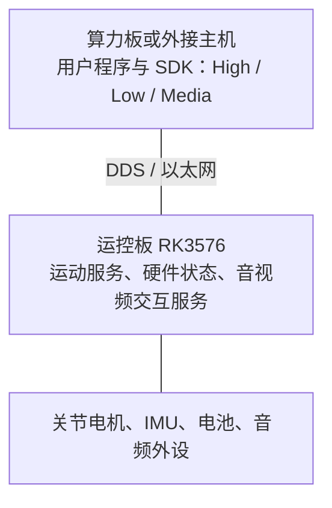
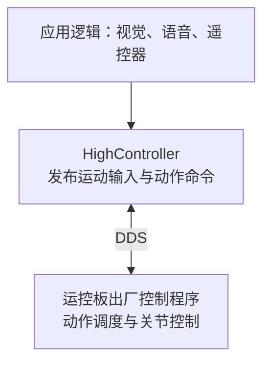
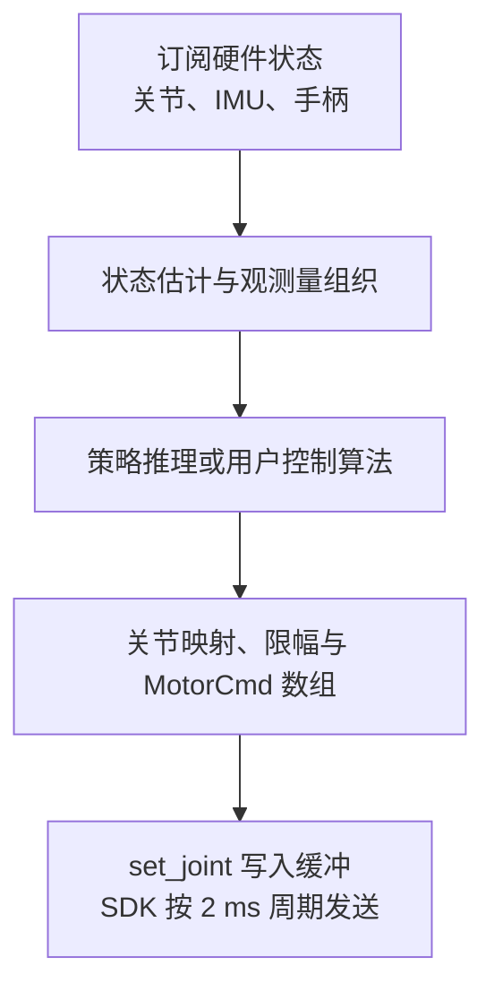

# Bumi 机器人综合使用手册

> 作者：祁果 ｜ 仓库：[77-GGG/bumi-handbooks](https://github.com/77-GGG/bumi-handbooks) ｜ PDF 版：[bumi-user-manual.pdf](../bumi-user-manual.pdf)
>
> 本文件由 LaTeX 工程 `user-manual/` 的章节源码逐段转换而成，内容与 PDF（39 页）一致，供全文检索与 AI 阅读使用。

## 目录

- [前言](#前言)
- [第 1 章 认识 Bumi](#第-1-章-认识-bumi)
  - [部件与自由度](#部件与自由度)
  - [整机参数与版本](#整机参数与版本)
  - [背部电气接口](#背部电气接口)
  - [机载计算机](#机载计算机)
  - [相机](#相机)
  - [电池与充电器](#电池与充电器)
- [第 2 章 开机、连接与充电](#第-2-章-开机连接与充电)
  - [准备场地](#准备场地)
  - [安装电池与启动](#安装电池与启动)
  - [使用 Noetix Run](#使用-noetix-run)
  - [移动与动作切换](#移动与动作切换)
  - [收纳与关机](#收纳与关机)
  - [充电](#充电)
- [第 3 章 开发前的基础知识](#第-3-章-开发前的基础知识)
  - [终端与工作目录](#终端与工作目录)
  - [Python、C++ 与 SDK](#pythonc-与-sdk)
  - [Conda 与虚拟环境](#conda-与虚拟环境)
  - [发布、订阅与回调](#发布订阅与回调)
  - [控制周期与命令类型](#控制周期与命令类型)
- [第 4 章 系统架构与网络连接](#第-4-章-系统架构与网络连接)
  - [程序运行在哪里](#程序运行在哪里)
  - [有线网络](#有线网络)
  - [登录算力板](#登录算力板)
  - [DDS 配置](#dds-配置)
- [第 5 章 准备环境与编译 SDK](#第-5-章-准备环境与编译-sdk)
  - [获取 SDK 与模型](#获取-sdk-与模型)
  - [Ubuntu 依赖](#ubuntu-依赖)
  - [ONNX Runtime 开发库](#onnx-runtime-开发库)
  - [选择 bumi_deploy 并构建](#选择-bumi_deploy-并构建)
  - [检查导入并启动例程](#检查导入并启动例程)
  - [使用官方 ARM Docker 镜像](#使用官方-arm-docker-镜像)
- [第 6 章 调用出厂动作](#第-6-章-调用出厂动作)
  - [HighController 的作用](#highcontroller-的作用)
  - [创建对象与订阅状态](#创建对象与订阅状态)
  - [硬件状态包含哪些数据](#硬件状态包含哪些数据)
  - [发布命令](#发布命令)
  - [使能与动作事件](#使能与动作事件)
  - [示教与播放](#示教与播放)
  - [保护状态与例程](#保护状态与例程)
- [第 7 章 控制关节与部署策略](#第-7-章-控制关节与部署策略)
  - [LowController 的作用](#lowcontroller-的作用)
  - [常用接口](#常用接口)
  - [关节命令的含义](#关节命令的含义)
  - [手柄输入](#手柄输入)
  - [ONNX 策略例程](#onnx-策略例程)
- [第 8 章 音频与语音交互开发](#第-8-章-音频与语音交互开发)
  - [媒体控制器](#媒体控制器)
  - [配置调用的时间间隔](#配置调用的时间间隔)
  - [交互配置与数据导向](#交互配置与数据导向)
  - [音频流格式](#音频流格式)
  - [视频流接口](#视频流接口)
  - [阅读完整例程](#阅读完整例程)
- [第 9 章 相机采集与图像处理](#第-9-章-相机采集与图像处理)
  - [选择图像入口](#选择图像入口)
  - [停止已有采集服务](#停止已有采集服务)
- [第 10 章 常见问题与排查](#第-10-章-常见问题与排查)
  - [编译与模块加载](#编译与模块加载)
  - [网络与状态订阅](#网络与状态订阅)
  - [动作与策略](#动作与策略)
  - [媒体与相机](#媒体与相机)
  - [保存一次运行记录](#保存一次运行记录)
- [附录 A 命令、模式与错误码](#附录-a-命令模式与错误码)
  - [ControlCmd](#controlcmd)
  - [出厂运动工作模式](#出厂运动工作模式)
  - [电机错误码](#电机错误码)
- [附录 B 关节参数](#附录-b-关节参数)
  - [编号、名称与扭矩](#编号名称与扭矩)
  - [角度范围](#角度范围)
- [附录 C 资源与视频索引](#附录-c-资源与视频索引)
  - [文档与仓库](#文档与仓库)
  - [官方操作视频](#官方操作视频)

---

# 前言

拿到一台机器人后，我们通常会先遇到三件事：认识它的部件，把它开起来，再让自己的程序与它通信。这本手册按这个顺序展开，先介绍硬件和日常操作，再说明开发环境，最后进入运动、音频和相机接口。

第一次使用 Bumi，可以从前两章开始，完成安装电池、连接 APP、起身和收纳。准备开发程序时，接着阅读第三至第五章，熟悉终端、Conda、网络和编译流程。调用出厂动作主要使用 HighController；部署自己的关节控制或运动策略，则使用 LowController。音视频接口和相机采集各自成章，便于按任务查阅。

命令需要在 Ubuntu 终端中执行。代码框中的路径和地址都对应具体用途：`~/noetix_sdk_bumi` 是本书示例使用的 SDK 根目录，`bumi_deploy` 是编译和运行共用的 Conda 环境，`192.168.55.102` 是运控板的默认地址。理解这些名字之后，再按自己的目录和网络填写命令，会更容易找到问题。

本文按[《Bumi 综合使用文档》](https://noetixrobotics.feishu.cn/docx/As2adPO27odPBfxQw1ucK6N4nNe)重新编排，并结合其链接的编译环境、音视频说明及项目内 SDK 3.1.0 核对示例。正文中的表格用于查参数，命令框用于操作，提示框解释动作发生的条件。附录集中列出控制命令、工作模式、关节范围和视频入口。

---

# 第 1 章 认识 Bumi

> **本章导读**
>
> 认识机器人的自由度、版本、接口和机载计算机，查阅相机、电池与充电器参数。

## 部件与自由度

Bumi 全身共有 21 个自由度。这里的自由度可以理解为一个独立控制的关节转动方向。单臂有 4 个，单腿有 6 个，腰部有 1 个，因此总数为 2×4+2×6+1=21。

- 手臂：肩关节 pitch、肩关节 roll、上臂 yaw、肘关节 pitch。
- 腿部：髋关节 pitch、髋关节 roll、大腿 yaw、膝关节 pitch、踝关节 pitch、踝关节 roll。
- 腰部：腰关节 yaw。

pitch、roll 和 yaw 分别表示俯仰、横滚和偏航。具体关节的正方向要结合模型坐标系阅读，电机编号、名称和范围见附录 B。


## 整机参数与版本

| 项目 | 参数 |
| --- | --- |
| 站立尺寸（高、宽、厚） | 约 98 cm × 35 cm × 20 cm |
| 带电池重量 | 约 17 kg |
| 总自由度 | 21；单臂 4、单腿 6、腰部 1 |
| 关节通信 | EtherCAT 与 CAN FD |
| 整机规格表中的最大关节扭矩 | 70 N·m |
| 大腿与小腿长度 | 合计约 513 mm |
| 手臂长度 | 约 312 mm |
| 供电 | 快拆锂电池；标称续航 2–3 小时 |
| 感知与交互 | IMU、相机、麦克风阵列、扬声器、APP 与 OTA |

官方外形尺寸图标注的整机高度为 988 mm，宽度为 350.46 mm，侧向厚度为 203.20 mm。整机概览采用取整尺寸；安装与结构设计可在[外观件尺寸图](https://noetixrobotics.feishu.cn/docx/As2adPO27odPBfxQw1ucK6N4nNe#J7iRd3pqzo6ICqxdHyHcfakQnff)中查看完整尺寸标注。关节控制使用附录中的逐关节参数。

| 项目 | 标准版 | 教育版 |
| --- | --- | --- |
| 基础算力 | 6 TOPS | 6 TOPS，部分型号另配 67 / 117 TOPS 算力板 |
| 算力模块 | 无独立 Jetson 算力板 | Jetson Orin Nano Super / NX；部分型号无算力板 |
| 相机 | `DC_V93` | RealSense D435i；EDU_Air 除外 |
| 图传 | 通过 APP 使用 | 开发时可在算力板访问相机硬件 |
| HighController | 支持 | 支持 |
| LowController | 未开放 | 支持 |

## 背部电气接口

背部提供 1 个 RJ45 千兆以太网口、2 个 USB 3.0 接口和 1 个 HDMI 接口。RJ45 采用 1000BASE-T。配有算力板的版本，背部接口连接算力板；未配算力板的版本，接口连接运控板。接线位置见[官方电气接口图](https://noetixrobotics.feishu.cn/docx/As2adPO27odPBfxQw1ucK6N4nNe#doxcnqSG6s08595TTZSMDbgjqRb)。

## 机载计算机

机器人内部的运控板负责运动控制。教育版中的 Jetson 算力板用于运行用户程序，两者通过网络通信。

| 项目 | 运控板 | 算力板 Nano Super | 算力板 NX |
| --- | --- | --- | --- |
| 平台 | RK3576 | Jetson Orin Nano Super | Jetson Orin NX |
| 默认 IP | `192.168.55.102` | `192.168.55.101` | `192.168.55.101` |
| 算力 | 6 TOPS | 67 TOPS | 117 TOPS |
| 主频 | 2.4 GHz | 1.7 GHz | 2.0 GHz |
| 内存与存储 | 8 + 64 GB | 8 + 128 GB | 16 + 128 GB |
| 用户登录 | 通过 SDK 接口访问功能 | 用户 `noetix` | 用户 `noetix` |

算力板出厂账户为 `noetix`，初始密码为 `bumi`。开发时登录算力板，运动命令通过 SDK 发给运控板。

## 相机

标准版使用 DC_V93 USB 摄像模组，最高有效像素为 2592×1944。教育版的 D435i 使用方法见第 9 章。

| DC_V93 项目 | 参数 |
| --- | --- |
| 感光尺寸与像素尺寸 | 1/4 英寸；1.4 μm × 1.4 μm |
| 图像格式 | MJPEG；YUV2（YUYV） |
| 接口 | USB 2.0 High Speed |
| 对焦 | 固定 / AF |
| 中心清晰度 | 800 LW/PH（Center） |
| 信噪比与动态范围 | 36 dB；71.6 dB |
| 灵敏度与最低照度 | 1.4 V/lux-sec @ 550 nm；0.5 lux |
| 自动控制 | 支持自动曝光、自动白平衡、自动增益 |
| 镜头 | 焦距 6.78 mm；光圈 F2.4；对角视场角 32.6° |
| 可调参数 | 亮度、对比度、饱和度、色调、清晰度、伽马、白平衡、逆光对比、曝光度 |

| 分辨率 | MJPEG 帧率 | YUV 帧率 |
| --- | --- | --- |
| 2592×1944 | 30 fps | 2 fps |
| 1920×1080 | 30 fps | 5 fps |
| 1280×720 | 30 fps | 8 fps |
| 848×480 | 30 fps | 20 fps |
| 640×480 | 30 fps | 30 fps |

## 电池与充电器

| 电池项目 | 参数 |
| --- | --- |
| 生产商 | 深圳格瑞普 |
| 型号 | `GRP6752097-13S1P` |
| 容量 | 5100 mAh |
| 标称电压 | 48 V |
| 重量 | 1360 g |

| 充电器项目 | 参数 |
| --- | --- |
| 型号 | TA300 Robot 智能充电器 |
| 输入 | 100–240 V AC；50/60 Hz；4.5 A |
| 支持电池 | LiPo / LiFe / LiHV；13S–16S |
| 输出 | 35–72 V DC；7.5 A；最大 350 W |
| 尺寸 | 172×97×46 mm |
| 重量 | 510±10 g |
| 工作模式 | 充电 |

---

# 第 2 章 开机、连接与充电

> **本章导读**
>
> 完成电池安装、启动、APP 连接、动作操作和关机充电，了解机器人运动所需的场地与摆放条件。

## 准备场地

选择平整、干燥、防滑的地面。起身和收纳时，周围留出约 3×3 m 的空间；舞蹈和移动时，根据动作幅度继续扩大活动区域，让人员、线缆和物品处于运动范围外。

雨水、潮湿和水雾会影响电气部件。松软地面、台阶、凹凸路面以及超过 20° 的坡面也会改变支撑条件。第一次使用从平整地面开始，开发调试全程使用吊架。

## 安装电池与启动

1. 从包装中取出机器人，放成稳定坐姿。
2. 将电池插入背部电池仓，确认卡扣锁定。
3. 短按电源键，看到指示灯后再长按，直到出现流水灯，等待启动完成。
4. 按操作要求将机器人面朝上平放，双腿伸直，手臂自然放在腰部两侧，给关节回零留出空间。

> **提示：起身前的姿态**
>
> “一键起身”从面朝上平躺的姿态开始。保持身体平放、四肢自然展开，关节处于可活动范围内。使用“辅助起身”时，按该功能的要求扶持机器人站立，再进行使能。

## 使用 Noetix Run

在手机上安装 Noetix Run。iPhone 可通过[App Store 页面](https://apps.apple.com/cn/app/noetix-run/id6751874215)安装；Android 下载二维码位于[官方 APP 章节](https://noetixrobotics.feishu.cn/docx/As2adPO27odPBfxQw1ucK6N4nNe#doxcn9WNtopSlikdBsw6SrXBVJ7)。打开 APP 后，按界面完成激活、绑定和设备连接，再使用起身、移动、基本动作、示教、舞蹈、动作库、图传和语音功能。

手机与机器人之间使用蓝牙和 Wi-Fi 通信，官方连接图同时给出了这两条链路。配网时按 APP 提示选择网络，保持手机和机器人的连接条件。



> **提示：保留蓝牙配对记录**
>
> 完成连接后保留手机系统中的设备配对记录。官方手册指出，使用“忽略设备”会清除蓝牙记录，之后可能需要售后协助恢复连接。

APP 的逐项操作见[Noetix Run 使用说明](http://app-file.noetixrobotics.com/page/appUseCn.html)。附录 C 按操作顺序列出了官方视频入口。

## 移动与动作切换

先完成起身并确认站稳，再使用移动或动作功能。每次切换后观察机器人当前状态，等前一个动作完成再进行下一项操作。快速连续切换会叠加身体惯性。

机器人行走时，控制器会继续输出关节力矩。需要搬动机器人时，先停止移动，再按收纳与关机流程操作。关节运动时，让手、衣物和线缆离开关节间隙。

## 收纳与关机

1. 在 APP 中执行“一键收纳”，等待机器人进入稳定坐姿。
2. 长按电源键关机，确认设备停止工作。
3. 按下电池卡扣，取出电池。

## 充电

将取出的电池放到配套充电底座并接好适配器，再把充电器接入交流电源。官方操作示例使用 220 V 插座，充电器输入范围见上一章。

充电过程中指示灯闪烁，充满后无指示。充电完成后断开充电器，妥善保存电池和线缆；下次使用时重新装入机器人。

---

# 第 3 章 开发前的基础知识

> **本章导读**
>
> 理解终端、工作目录、Python 扩展、虚拟环境和控制周期，为后面的编译与接口调用建立共同语境。

## 终端与工作目录

终端把输入的命令交给 Shell 执行。开发时经常同时打开几个终端，每个终端都有自己的工作目录和环境。进入一个终端后，先看当前在哪里，再选择项目环境：

```bash
pwd
ls
cd ~/noetix_sdk_bumi
conda activate bumi_deploy
```

`pwd` 显示当前位置，`ls` 列出文件，`cd` 切换目录。波浪号表示当前用户的主目录。`./build`、`config/dds.xml` 等相对路径从当前工作目录出发，因此本书的 SDK 命令都从项目根目录执行。

长命令末尾的反斜杠表示续行，下一行仍属于同一条命令。命令后的参数用于指定选项，例如 `--parallel 2` 让构建工具同时使用两个任务。

## Python、C++ 与 SDK

C++ 源文件先经编译和链接，生成可执行程序或共享库。Python 脚本由解释器执行；当它导入 `highcontrol_py` 时，实际加载的是 C++ 经 pybind11 封装的扩展模块。

这意味着 Python 示例也需要先编译 SDK。编译时选用哪个 Python，运行时就继续使用那个环境中的 Python。`pip install onnxruntime` 提供 Python 包；CMake 查找的 ONNX Runtime 开发库还包含 C++ 头文件、共享库和 CMake 配置，两者分别服务于 Python 与 C++。

## Conda 与虚拟环境

虚拟环境把一个项目所需的解释器和软件包放到独立目录中。Conda 同时管理环境和包，Miniconda 则提供较小的 Conda 安装入口。pip 用于安装 Python 包，本书用 `python -m pip` 明确指定当前解释器。

先执行 `conda --version` 查看 Conda 是否已安装。尚未安装时，按[Miniconda Linux 安装说明](https://www.anaconda.com/docs/getting-started/miniconda/install/linux-install)选择与 `uname -m` 输出匹配的安装器，在自己的用户目录中安装。初始化 Bash 后重新打开终端，再创建环境：

```bash
conda create -n bumi_deploy python=3.10 pip
conda activate bumi_deploy
python --version
python -c "import sys; print(sys.executable)"
python -m pip --version
conda info --envs
```

创建命令执行一次即可。以后每次打开终端，用 `conda activate bumi_deploy` 激活；`conda deactivate` 退出当前环境。激活会调整当前 Shell 的程序查找路径，环境本身仍保存在磁盘上。

> **概念：环境与目录各管什么**
>
> `conda activate bumi_deploy` 选择解释器与软件包，`cd ~/noetix_sdk_bumi` 选择文件查找的起点。一个终端中完成这两步后，才能同时使用正确的 Python 和项目路径。

编译与部署都使用 `bumi_deploy`。下面安装示例所需的 Python 包：

```bash
python -m pip install numpy pyyaml onnxruntime pybind11
python -c "import numpy, yaml, onnxruntime, pybind11; print('python deps ok')"
python -m pip check
```

环境配置完成后，保存版本记录：

```bash
conda env export --no-builds > environment-tested.yml
python -m pip freeze > requirements-tested.txt
```

在另一台机器上，根据环境清单重新创建环境，再编译 SDK 扩展。分享清单前移除 YAML 中的本机 `prefix:` 路径。

## 发布、订阅与回调

DDS 把通信数据组织成主题。发布者向主题写入数据，订阅者收到数据后调用注册的函数，这个函数就是回调。SDK 中，程序发布控制命令，同时订阅电机、IMU、遥控器、电池和工作模式。

回调中只做短时间的数据复制和状态更新，把模型推理、文件保存等工作放在其他执行流程中。这样通信和计算可以各自按需要运行。

## 控制周期与命令类型

运动控制链路的周期为 2 ms，对应 1/0.002=500 Hz。HighController 中，一类数据是连续更新的运动输入，另一类是触发一次动作的事件命令。播放示教等事件发出一次后，后续周期回到 `DEFAULT`，避免每周期重新触发。

音视频配置有自己的节奏：修改音量、数据开关等 agent 配置时，调用间隔至少 500 ms。运动命令的 2 ms 周期与媒体配置的 500 ms 间隔分别用于不同接口。

---

# 第 4 章 系统架构与网络连接

> **本章导读**
>
> 明确程序运行的位置，连接算力板，并让 DDS 客户端与运控板建立通信。

## 程序运行在哪里

用户程序可以运行在机器人算力板，也可以运行在外接 Ubuntu 主机。HighController 调用运控板上的出厂运动能力；LowController 由用户程序生成 21 个关节命令，再经运控板送往电机。两种方式都能接收机器人硬件状态。



SDK 的通信实现使用 CycloneDDS 0.11.0。运动命令与硬件状态以 500 Hz 的节奏交换。开发时先确认网络可达，再运行控制程序。

## 有线网络

运控板默认地址为 `192.168.55.102`，算力板默认地址为 `192.168.55.101`。外接主机使用同一网段中未被占用的地址，例如 `192.168.55.100/24`。

```bash
ip -br addr
ip route
ping -c 4 192.168.55.102
```

`ip -br addr` 显示网卡及地址。网卡名可能是 `enp3s0`、`eno1` 或其他名称，按实际输出识别有线网卡。机器人算力板已经使用 `.101` 时，外接主机选择其他地址。

## 登录算力板

通过有线网络登录：

```bash
ssh noetix@192.168.55.101
```

连接后输入算力板密码。无线连接时，先在 APP 的连接信息中查看机器人 Wi-Fi 地址，再用该地址和端口 2222：

```bash
ssh -p 2222 noetix@ROBOT_WIFI_IP
```

将 `ROBOT_WIFI_IP` 换成 APP 显示的实际地址。无线入口经机器人运控板的 Wi-Fi 转发到算力板。

## DDS 配置

在 SDK 根目录中查看 `config/dds.xml`。本地 SDK 的配置使用 UDP，关闭组播，并把运控板地址写成发现节点：

```xml
<CycloneDDS>
  <Domain id="any">
    <General>
      <Transport>udp</Transport>
      <AllowMulticast>false</AllowMulticast>
    </General>
    <Discovery>
      <ParticipantIndex>auto</ParticipantIndex>
      <Peers>
        <Peer address="192.168.55.102"/>
      </Peers>
      <SPDPInterval>50</SPDPInterval>
    </Discovery>
  </Domain>
</CycloneDDS>
```

通过环境变量指定配置文件：

```bash
export CYCLONEDDS_URI="file://$(pwd)/config/dds.xml"
```

例程也会设置该变量；运行前检查它指向当前项目中的文件。多网卡主机可以结合路由表确定到 `192.168.55.102` 的出口。

---

# 第 5 章 准备环境与编译 SDK

> **本章导读**
>
> 下载 SDK，准备 Ubuntu 与 Conda 依赖，生成 C++ 例程和 Python 扩展；另列出官方 ARM Docker 环境的使用方法。

## 获取 SDK 与模型

从[Bumi SDK 仓库](https://github.com/Noetix-Robotics/noetix_sdk_bumi)获取程序：

```bash
cd ~
git clone https://github.com/Noetix-Robotics/noetix_sdk_bumi.git
cd ~/noetix_sdk_bumi
```

项目内下载目录名为 `noetix_sdk_bumi-main` 时，后续路径相应替换。关节模型 `Bumi_URDF.zip` 在官方手册的 URDF 小节，训练框架位于[noetix_bumi_lab](https://github.com/Noetix-Robotics/noetix_bumi_lab)。

| 目录或文件 | 用途 |
| --- | --- |
| `build.sh` | SDK 构建脚本 |
| `CMakeLists.txt` | 依赖查找、Python 扩展和可执行目标 |
| `config/` | DDS 与策略配置 |
| `dds/` | 按 CPU 架构区分的 DDS 库 |
| `examples/cpp/` | C++ 例程 |
| `examples/py/` | Python 例程 |
| `include/` | 控制器与公共结构体头文件 |
| `lib/` | SDK 原生库 |
| `policy/` | 策略模型 |
| `pybind/` | Python 绑定源码 |
| `build/` | 编译生成的扩展模块与例程 |

## Ubuntu 依赖

官方编译环境说明采用 Ubuntu 22.04。先安装工具链和开发包：

```bash
sudo apt update
sudo apt install -y build-essential git cmake \
  libeigen3-dev libfmt-dev pybind11-dev python3-dev \
  python3-pip libyaml-cpp-dev libglib2.0-dev \
  libboost-all-dev libgoogle-glog-dev \
  libprotobuf-dev protobuf-compiler
```

本地 SDK 使用 C++17，CMake 最低版本声明为 3.16，并查找 ONNX Runtime、Eigen3、Threads 和 pybind11；策略目标还链接 yaml-cpp。

官方环境文档提供了 x86_64 的 CMake 3.26.3 包、ARM 的 3.31.8 安装器，以及 ONNX Runtime、glog、spdlog 等附件。需要自行构建这些依赖时，从[SDK 编译环境部署流程](https://noetixrobotics.feishu.cn/docx/PP2BdXkSUoQ2VOxctJKcEdHanAg)获取对应架构的资源。先运行 `uname -m` 确认 CPU 架构，再选安装包。

## ONNX Runtime 开发库

CMake 需要找到 ONNX Runtime 的开发安装。使用官方环境说明中的源码附件构建时，在解压后的源码目录执行：

```bash
./build.sh --config Release --build_shared_lib --parallel 2
cd build/Linux/Release
sudo make install
sudo ldconfig
```

这里的 `build.sh` 属于 ONNX Runtime 源码目录。SDK 自身也有同名脚本，执行前先用 `pwd` 确认所在目录。

如果开发库已安装在自定义目录，配置 SDK 时用 `onnxruntime_DIR` 指向包含 `onnxruntimeConfig.cmake` 的目录。`python -m pip install onnxruntime` 用于 Python 推理依赖，C++ 构建继续使用开发库。

## 选择 bumi_deploy 并构建

按照第三章创建环境并安装 Python 包后，在 SDK 根目录配置：

```bash
conda activate bumi_deploy
cd ~/noetix_sdk_bumi
cmake -S . -B build \
  -DPYBIND11_FINDPYTHON=ON \
  "-DPython_EXECUTABLE=$(python -c 'import sys; print(sys.executable)')" \
  "-Dpybind11_DIR=$(python -m pybind11 --cmakedir)"
cmake --build build --parallel 2
```

这组参数把 pybind11 和 Python 都指向当前环境。若 `build/` 已由其他解释器配置，先把它改名保存，例如 `mv build build-before-conda`，再重新配置。

> **预期结果**
>
> `build/` 中生成 `example_high`、`example_low`、`example_policy`、`example_media`，以及 `highcontrol_py`、`lowcontrol_py`、`mediacontrol_py` 对应的扩展模块。

## 检查导入并启动例程

先检查 Python 和模块位置：

```bash
python -c "import sys; sys.path.insert(0, './build'); import highcontrol_py; print(sys.executable); print(highcontrol_py.__file__)"
```

完成网络配置并准备好吊架后，按开发任务选一个例程运行：

```bash
python examples/py/test_high.py
```

低层控制使用 `examples/py/test_low.py`，策略示例使用 `examples/py/test_policy.py`。C++ 的相应程序位于 `build/`，例如：

```bash
sudo ./build/example_high
```

## 使用官方 ARM Docker 镜像

官方提供的 `noetix_dds.tar.gz` 面向 aarch64。解压后包含镜像 `noetix_dds.tar` 和 Compose 配置。导入镜像并创建工作目录：

```bash
tar -zxvf noetix_dds.tar.gz
docker load -i noetix_dds.tar
docker images
mkdir -p /home/noetix/work
```

Compose 中保留 host 网络和工作目录映射：

```yaml
services:
  noetix_dds:
    image: noetix_dds:arm64
    container_name: noetix_dds
    network_mode: host
    volumes:
      - /home/noetix/work:/home/noetix/work:rw
    stdin_open: true
    tty: true
```

```bash
docker compose -f noetix_dds.yaml up -d
docker ps
docker exec -it noetix_dds /bin/bash
```

把 SDK 放到映射的工作目录中，在容器内继续配置和编译。容器中的路径、Python 和开发库按容器环境检查；在主机创建的 Conda 环境由主机终端使用。

---

# 第 6 章 调用出厂动作

> **本章导读**
>
> 使用 HighController 获取状态、发送运动输入和触发出厂动作，理解使能切换与示教播放的调用方法。

## HighController 的作用

HighController 将应用程序中的动作请求交给机器人的出厂运动控制程序。例如，视觉程序识别到来人后可以请求挥手，语音程序可以把交互结果转换为动作命令。应用程序同时接收电机、IMU、电池和工作模式，了解机器人正在做什么。

**HighController 的数据流程**



## 创建对象与订阅状态

C++ 通过 `HighController::Instance()` 取得单例，Python 通过 `HighController.instance()` 取得单例。`init()` 初始化通信，返回布尔值。随后注册 `subscribe_robot_hardware_status(callback)`，在回调中接收 `RobotHardwareStatus`。

下面的 Python 示例仅订阅并显示工作模式，可保存为 SDK 根目录中的 `read_status.py`：

```python
import os
import sys
import time

os.environ["CYCLONEDDS_URI"] = "file://" + os.path.abspath("config/dds.xml")
sys.path.insert(0, os.path.abspath("build"))
from highcontrol_py import HighController

ctrl = HighController.instance()
if not ctrl.init():
    raise RuntimeError("HighController init failed")

last_mode = None
def on_status(status):
    global last_mode
    if status.workmode != last_mode:
        last_mode = status.workmode
        print("workmode:", last_mode)

ctrl.subscribe_robot_hardware_status(on_status)
try:
    while True:
        time.sleep(0.1)
except KeyboardInterrupt:
    pass
```

在项目根目录执行 `python read_status.py`。工作模式变化时打印一次，使用 `Ctrl+C` 结束状态读取。

## 硬件状态包含哪些数据

| **成员** | **内容** |
| --- | --- |
| `imu_data` | IMU 四元数、角速度、线加速度及协方差 |
| `remote_data` | 两个摇杆轴和 14 个按键值 |
| `motor_data` | 21 个电机的状态数组 |
| `bms_data` | 电池温度、告警、荷电状态和健康状态 |
| `workmode` | 当前出厂运动工作模式 |

`MotorState` 包含 `pos`、`vel`、`tau`、`motor_id`、`error` 和 `temperature`，分别表示位置、速度、力矩、电机编号、错误码和温度。角度使用弧度。

`NingImuData` 中，`ori[4]` 为姿态四元数，`angular_vel[3]` 为角速度，`linear_acc[3]` 为线加速度；相应的 `*_cov[9]` 为协方差数组。四元数的分量顺序在计算前应与实际绑定及模型约定对应。

`RobotBmsData` 的四个成员为 `battery_temp_`、`battery_alarm_`、`battery_soc_` 和 `battery_soh_`。处理 Python 对象时保留字段末尾的下划线。

## 发布命令

发布接口在 C++ 中的原型为：

```cpp
void publish_cmd(double x, double y, double z,
                 ControlCmd action, uint16_t index);
```

Python 使用同名方法，参数同样为五个：

```python
ctrl.publish_cmd(x, y, z, action, index)
```

| **参数** | **含义** |
| --- | --- |
| `x` | 前后方向输入，范围 [-1, 1]；正值向前 |
| `y` | 左右平移输入，范围 [-1, 1]；正值向左 |
| `z` | 转向输入，范围 [-1, 1]；正值左转 |
| `action` | `ControlCmd` 动作命令 |
| `index` | 示教文件等动作资源的索引 |

这些运动输入是归一化输入值，实际运动效果由运控程序决定。发布调用间隔至少 2 ms。出厂控制在 WALK、SWING、SHAKE、CHEER、TEAR、PLAYTEACH、DEFAULT 等模式下处理相应运动输入。

## 使能与动作事件

> **提示：START 是状态切换命令**
>
> 当前 `workmode == 30`（失能）时，`START` 执行使能；在其他工作模式下，`START` 会立即失能。调用前先读取工作模式，并把这个条件写入应用逻辑。

`SWITCH` 用于准备，`WALK` 进入走路，`SWING`、`SHAKE`、`CHEER` 分别触发挥手、握手和欢呼。动作命令全集与工作模式编号见附录 A。

事件命令发送一次，后续周期继续使用 `DEFAULT`。下面展示一个动作事件的发送形式；执行前机器人已处于适合该动作的站立状态，并完成使能与准备：

```python
from highcontrol_py import ControlCmd

ctrl.publish_cmd(0.0, 0.0, 0.0, ControlCmd.CHEER, 0)
time.sleep(0.002)
ctrl.publish_cmd(0.0, 0.0, 0.0, ControlCmd.DEFAULT, 0)
```

在持续运行的控制循环中，按键按下沿产生一次事件。每周期同时根据摇杆更新连续运动输入，避免把持续按住按键当成反复触发动作。

## 示教与播放

示教按“开始、记录、保存、播放”的顺序进行。`STARTTEACH` 开始示教，`SAVETEACH` 保存示教；`ENDTEACH` 在官方接口表中标为弃用。

播放时指定动作索引，`PLAYTEACH` 发出一次后恢复空指令：

```python
file_index = 0
ctrl.publish_cmd(0.0, 0.0, 0.0, ControlCmd.PLAYTEACH, file_index)
time.sleep(0.002)
ctrl.publish_cmd(0.0, 0.0, 0.0, ControlCmd.DEFAULT, file_index)
```

持续发送 `PLAYTEACH` 会反复重置播放过程。观察到动作停在开头时，先检查这一处调用。

## 保护状态与例程

当 IMU 检测到姿态超过站立保护阈值时，出厂控制进入保护状态，关节失能并终止当前策略。应用程序通过 `workmode` 识别保护状态，再按机器人姿态安排后续操作。

官方 HighController 示例对应本地 `examples/cpp/example_high.cpp` 和 `examples/py/test_high.py`。阅读顺序可以是：初始化、注册回调、读取输入、检测按键边沿、选择命令、发布命令。教育版从本地手柄取输入时，使用 AoLionDriver，见下一章。

---

# 第 7 章 控制关节与部署策略

> **本章导读**
>
> 理解 LowController 的关节命令、编号映射和发送缓冲区，阅读手柄输入与 ONNX 策略例程。

## LowController 的作用

教育版开放 LowController，用户程序可以直接给出 21 个电机的目标位置、速度、力矩和 PD 增益。运控板负责把命令传给硬件，并上报实时状态。开发时用吊架支撑机器人，再检查关节映射和目标范围。

**LowController 策略运行流程**



## 常用接口

| **接口** | **作用** |
| --- | --- |
| `LowController::Instance()` | C++ 取得单例；Python 使用 `instance()` |
| `init()` | 初始化控制器和通信 |
| `set_joint(cmd)` | 更新含 21 个 MotorCmd 的关节命令数组 |
| `getJointsIndex(name)` | 根据关节名称取得硬件索引 |
| `subscribe_robot_hardware_status(callback)` | 注册硬件状态回调 |

C++ 的关节命令原型为：

```cpp
void set_joint(std::array<MotorCmd, 21> cmd);
```

`set_joint` 更新最新命令缓冲区，SDK 的发送线程按约 2 ms 的周期读取缓冲并发布。算法更新频率与通信发送频率分别安排：每次有新目标，就更新完整关节数组。

## 关节命令的含义

```cpp
struct MotorCmd {
    double pos;
    double vel;
    double tau;
    double kp;
    double kd;
    uint16_t motor_id;
};
```

`pos` 为目标角度，单位 rad；`vel` 为目标角速度，`tau` 为力矩项；`kp`、`kd` 为位置与速度反馈增益。按 SDK 接口组织这六项，再将每个命令放到对应关节的位置。

模型中的关节顺序可能与硬件数组不同。使用关节名称调用 `getJointsIndex`，把每个模型输出映射到正确的电机。附录 B 提供 21 个名称、编号与角度范围。

> **概念：弧度与角度**
>
> SDK 使用弧度，结构参数中也常见角度制。两者关系为 θ_rad = θ_deg × π/180。例如 90° 等于约 1.571 rad。发送目标之前，把模型输出、默认姿态和关节范围统一到同一单位。

## 手柄输入

教育版可使用 AoLionDriver 读取本机手柄：

```python
from lowcontrol_py import AoLionDriver
al = AoLionDriver()
al.init("/dev/input/js0", 115200)
remote = al.getremotedata()
```

手柄数据包含 `axes[2]` 和 `button[14]`。本地例程把 `axes[1]` 用于前后运动，把 `axes[0]` 用于转向。

| **按键** | **数组索引** |
| --- | --- |
| RB | 1 |
| LB | 2 |
| X | 5 |
| Y | 6 |
| B | 7 |
| A | 8 |
| 加号 | 9 |
| 减号 | 10 |
| 左摇杆按下 | 12 |

按键索引只描述原始输入。某个组合键执行什么功能，由当前例程的控制逻辑决定。阅读程序时从 `button[index]` 的判断开始，再看它修改了哪一个模式或命令。

## ONNX 策略例程

本地 C++ 策略源文件为 `examples/cpp/example_policy.cpp`，构建目标为 `build/example_policy`；Python 对应 `examples/py/test_policy.py`。模型默认放在 `policy/policy.onnx`。

典型流程包括加载模型、读取策略参数、初始化关节姿态、组织观测量、执行推理、处理动作输出和更新关节命令。训练框架在[Bumi Lab 仓库](https://github.com/Noetix-Robotics/noetix_bumi_lab)。

1. 对照配置中的关节名称和默认姿态，建立模型到硬件的索引映射。
2. 核对观测量的顺序、缩放系数、历史帧和模型输入尺寸。
3. 核对动作输出的缩放、默认姿态叠加方式及关节限幅。
4. 在吊架上检查单次模式切换与目标变化，再开展运动测试。

运行命令为：

```bash
conda activate bumi_deploy
cd ~/noetix_sdk_bumi
python examples/py/test_policy.py
```

退出前，按例程的状态切换流程让机器人进入稳定姿态，再结束进程。

---

# 第 8 章 音频与语音交互开发

> **本章导读**
>
> 使用 MediaController 订阅状态、调整交互配置、收发音频和视频流，掌握媒体数据格式及配置调用间隔。

## 媒体控制器

教育版开放 MediaController。它通过 DDS 与运控板上的语音交互模块通信，控制扬声器、麦克风以及交互 agent 的部分配置。使用 `MediaController::Instance()` 或 Python 的 `MediaController.instance()` 取得对象，随后调用 `init()`。

媒体开发有四类任务：系统状态控制，交互配置，音频数据流，视频数据流。`subscribe_system_status` 接收状态变化，`subscribe_system_error` 接收错误信息。`SystemStatus` 带有报文头、当前状态和变化原因；`SystemError` 带有报文头、错误码和错误消息。

| **控制值** | **作用** |
| --- | --- |
| `TO_WAKEUP` | 唤醒语音交互系统 |
| `TO_SLEEP` | 进入休眠 |
| `TO_RESET` | 重启语音交互系统 |

当前状态包含 `READY`、`SLEEPED`、`WAKEUPED` 和 `EXIT`。变化原因可以区分系统启动、命令重启、语音或命令唤醒、语音或命令休眠、超时休眠和错误休眠。

## 配置调用的时间间隔

> **提示：两次配置调用至少间隔 500 ms**
>
> 音量、超时和数据导向开关等 agent 配置接口，每次调用后留出至少 500 ms，再执行下一次配置调用。把配置放在初始化或用户操作流程中，媒体数据流按各自采样节奏处理。

音量范围为 0–200；休眠超时使用毫秒。`get_volume` / `set_volume` 获取和设置音量，`get_timeout` / `set_timeout` 获取和设置无响应休眠时间。

下面的 Python 例子显示状态并设置一次音量，可保存为 SDK 根目录中的 `media_status.py`：

```python
import os
import sys
import time

os.environ["CYCLONEDDS_URI"] = "file://" + os.path.abspath("config/dds.xml")
sys.path.insert(0, os.path.abspath("build"))
from mediacontrol_py import MediaController

ctrl = MediaController.instance()
if not ctrl.init():
    raise RuntimeError("MediaController init failed")

ctrl.subscribe_system_status(lambda status: print("state:", status.value))
ctrl.subscribe_system_error(lambda error: print("error:", error.code, error.message))
time.sleep(0.5)
ctrl.set_volume(80)
time.sleep(0.5)

try:
    while True:
        time.sleep(0.1)
except KeyboardInterrupt:
    pass
```

## 交互配置与数据导向

读写开关的方法采用 `get_` 与 `set_` 前缀。下表列出其余名称部分，组合后即可在头文件中找到完整接口。例如第一项的写接口是 `set_audio_cue_enable(bool)`。

| **配置名称** | **作用** |
| --- | --- |
| `audio_cue_enable` | 交互提示音 |
| `internal_capture_audio_data_to_agent_enable` | 内部麦克风音频输入 agent |
| `external_custom_audio_data_to_agent_enable` | 外部音频输入 agent |
| `internal_agent_audio_data_to_playback_enable` | agent 回复输出到内部扬声器 |
| `external_custom_audio_data_to_playback_enable` | 外部音频输出到内部扬声器 |
| `internal_capture_video_data_to_agent_enable` | 内部视频输入 agent |
| `external_custom_video_data_to_agent_enable` | 外部视频输入 agent |
| `external_custom_audio_data_to_agent_use_internal_3a` | 外部音频使用内部 3A 算法 |

唤醒与回复词接口包括 `get_wakeup_words`、`add_wakeup_words`、`reset_wakeup_words`，以及 `get/set_wakeup_response_words` 和 `get/set_sleep_response_words`。添加唤醒词会追加用户词语，恢复默认会清除用户追加内容。

## 音频流格式

`AudioStream` 包含报文头 `header`、微秒时间戳 `timestamp_us`、通道数 `channels`、采样率 `sample_rate`、格式 `format`、时长 `duration_ms` 和采样数组 `audio_data`。

| **用途** | **通道数** | **采样率** | **格式** |
| --- | --- | --- | --- |
| 采集输入 / 输出 | 8 | 16000 Hz | 2：小端 16 位 |
| 扬声器播放输入 / 输出 | 2 | 16000 Hz | 2：小端 16 位 |

采样数据按通道交错排列。例如双声道是左、右、左、右依次排列。时长为 t 秒、采样率为 f_s、通道数为 c 时，采样数组元素个数为 t × f_s × c。

`subscribe_internal_audio_capture` 接收内部麦克风采集流，`subscribe_internal_audio_playback` 接收内部播放流。`publish_external_audio_stream` 将外部音频交给 agent，`publish_external_audio_playback_stream` 将外部音频交给扬声器。采集和播放各有 `pause_audio_*` 与 `resume_audio_*` 接口。

## 视频流接口

`VideoStream` 包含报文头、微秒时间戳、格式、宽、高、帧率和字节数组 `video_data`。官方媒体接口当前支持格式值 1，即 YUYV。

未配算力板的 Bumi 可用 `subscribe_internal_video_capture` 订阅内部相机，通过 `pause_video_capture` 和 `resume_video_capture` 控制采集。配算力板的版本直接在算力板读取相机，调用 `publish_external_video_stream` 将视频送入交互系统；持续输入后，可用 `subscribe_internal_video_desensed` 接收加工后的脱敏流。

## 阅读完整例程

本地 `examples/py/test_media.py` 提供配置查看、音频采集、播放和媒体流处理。C++ 对应 `examples/cpp/example_media.cpp`。运行前在 `bumi_deploy` 中编译好 `mediacontrol_py`。完整参数说明见[Bumi 音视频开发 MediaController](https://noetixrobotics.feishu.cn/docx/DSXLdLLOXo15vKx4baDcXOfTnue)。

---

# 第 9 章 相机采集与图像处理

> **本章导读**
>
> 区分相机硬件采集、APP 图传和媒体交互输入，处理 RealSense 相机与系统采集服务的占用关系。

## 选择图像入口

标准版 DC_V93 的参数见第一章。教育版 EDU_Pro、EDU_MAX、EDU_Tailor 等配有算力板的版本，相机连接算力板，开发程序可以通过硬件 SDK 读取图像。D435i 使用[librealsense](https://github.com/IntelRealSense/librealsense)。

相机采集得到的图像可用于识别、定位、导航或应用逻辑。若还需要给机器人的语音交互 agent 提供画面，将采集结果转换为媒体接口要求的 YUYV 数据，再发布外部视频流。

## 停止已有采集服务

机器人原有图传服务可能正在使用相机。开始自己的采集程序前，在算力板停止该服务：

```bash
sudo systemctl stop noetix-video-capture.service
systemctl status noetix-video-capture.service
```

`stop` 停止本次运行。若后续开发都由自己的程序采集，可以关闭开机启动：

```bash
sudo systemctl disable noetix-video-capture.service
```

完成开发、准备恢复系统图传时，先结束自己的相机程序，再恢复服务：

```bash
sudo systemctl start noetix-video-capture.service
sudo systemctl enable noetix-video-capture.service
```

`start` 启动当前服务，`enable` 恢复开机自动启动。

---

# 第 10 章 常见问题与排查

> **本章导读**
>
> 按构建、模块加载、网络、动作和媒体的顺序定位问题，保留能说明当前状态的输出。

## 编译与模块加载

> **常见问题：CMake 找不到 onnxruntime**
>
> 检查 C++ 开发库是否已经安装，以及是否包含 CMake 配置文件。自定义安装位置通过 `onnxruntime_DIR` 指定。Python 能导入 onnxruntime，说明 Python 包可用；继续检查 CMake 使用的开发安装。

> **常见问题：ModuleNotFoundError: highcontrol_py / lowcontrol_py**
>
> 先进入 SDK 根目录，检查 `build/` 中的扩展文件，再确认脚本把 `./build` 加到了搜索路径。用 `python -c "import sys; print(sys.executable)"` 检查是否为 `bumi_deploy` 的解释器。更换解释器后重新配置和构建扩展。

> **常见问题：ImportError 或 GLIBCXX 等原生库错误**
>
> 使用 `ldd build/lowcontrol_py*.so` 查看依赖路径与 `not found` 项。根据输出补齐原生库，检查实际加载的是 Conda 库还是系统库，再统一构建与运行环境。

> **常见问题：运行时报缺少 libssl.so.1.1**
>
> 官方手册提供 ARM 和 x86 两种 libssl1.1 安装包。用 `uname -m` 确认架构，从官方手册取得相应附件后安装。ARM 示例：
>
> ```bash
> sudo dpkg -i libssl1.1_1.1.1f-1ubuntu2.16_arm64.deb
> ```
>
> x86_64 示例：
>
> ```bash
> sudo dpkg -i libssl1.1_1.1.1f-1ubuntu2_amd64.deb
> ```

## 网络与状态订阅

> **常见问题：能登录算力板，却收不到硬件状态**
>
> SSH 连接的是算力板，DDS 对端是运控板。继续检查到 `192.168.55.102` 的连接、路由、DDS Peer 和 `CYCLONEDDS_URI`。先运行只读状态示例，看到回调后再加入动作发送。

> **常见问题：外接主机和机器人发生地址冲突**
>
> 核对 `ip -br addr`。算力板通常占用 `192.168.55.101`，运控板占用 `192.168.55.102`；为外接主机选择同网段的其他空闲地址，再测试连接。

## 动作与策略

> **常见问题：按 START 后机器人失能**
>
> 读取命令发出前的 `workmode`。START 只在失能状态 30 下执行使能，其他状态下执行失能。应用程序按状态决定是否发送，并对按键做边沿触发。

> **常见问题：示教播放总停在开头**
>
> 检查是否在每个控制周期发送 PLAYTEACH。播放事件发送一次，之后继续发 DEFAULT；示教文件索引保持所需值。

> **常见问题：关节目标与预期部位不对应**
>
> 检查模型输出顺序、关节名称、`getJointsIndex` 结果和 `motor_id`。把所有角度转换为 rad，再对照附录逐项检查范围。

> **常见问题：进入保护状态后动作不再执行**
>
> 查看 IMU、工作模式和电机错误。先恢复机器人所需姿态及支撑条件，再按对应操作流程继续。调试日志应同时记录状态变化与发出的动作命令。

## 媒体与相机

> **常见问题：修改配置后语音模块异常**
>
> 检查音量、超时、数据开关等 agent 配置的调用间隔，让相邻调用至少间隔 500 ms。把配置写入从运动的 500 Hz 循环移到初始化或独立的用户操作流程中。

> **常见问题：外部音频播放不正确**
>
> 核对播放数据为双通道、16000 Hz、小端 16 位且按通道交错排列。再确认外部音频到扬声器的开关，以及数组元素数量与时长字段是否一致。

> **常见问题：相机无法打开或画面被占用**
>
> 检查系统的 `noetix-video-capture.service` 状态，停止原有采集后再启动自己的程序。结束开发时关闭自己的采集程序，再恢复系统服务。

## 保存一次运行记录

记录 Ubuntu 与 CPU 架构、SDK 版本、Python 路径、模型和配置版本，再保存完整报错及相关状态。下面的命令用于建立基本环境记录：

```bash
uname -a
uname -m
python --version
python -c "import sys; print(sys.executable)"
ip -br addr
ip route
```

针对动作问题，增加工作模式、指令时间、电机错误码和 IMU；针对媒体问题，增加媒体状态、错误消息、流格式和配置调用时间。

---

# 附录 A 命令、模式与错误码

## ControlCmd

命令值按项目内 SDK 3.1.0 的枚举顺序列出。程序优先使用枚举名称，阅读日志时再对照数值。

| 值 | 名称 | 含义 |
| --- | --- | --- |
| 0 | `WALK` | 走路 |
| 1 | `SWING` | 挥手 |
| 2 | `SHAKE` | 握手 |
| 3 | `CHEER` | 欢呼 |
| 4 | `RUN` | 预留，当前不可用 |
| 5 | `START` | 失能时使能；其他模式失能 |
| 6 | `SWITCH` | 准备 |
| 7 | `STARTTEACH` | 开始示教 |
| 8 | `SAVETEACH` | 保存示教 |
| 9 | `ENDTEACH` | 结束示教，已弃用 |
| 10 | `PLAYTEACH` | 播放指定示教 |
| 11 | `DANCE` | 舞蹈 1 |
| 12 | `FALLTOSTAND` | 倒地起身 |
| 13 | `STANDTOFALL` | 起身倒地 / 收纳 |
| 14 | `DANCE1` | 舞蹈 2 |
| 15 | `DANCE2` | 舞蹈 3 |
| 16 | `TEAR` | 擦泪 |
| 17 | `DEFAULT` | 空指令 |

## 出厂运动工作模式

`workmode` 表示 HighController 出厂运控状态。它与 `ControlCmd` 是两套编号。例如命令 START 的值为 5，失能状态的编号为 30；根据字段名称分别查表。

| workmode | 含义 | workmode | 含义 |
| --- | --- | --- | --- |
| 0 | 使能 | 23 | 播放示教 |
| 1 | 准备 | 26 | 保护 |
| 2 | 走路 | 27 | 倒地起身 |
| 5 | 舞蹈 | 28 | 起身倒地 |
| 8 | 打招呼 | 29 | 保存示教 2 |
| 9 | 握手 | 30 | 失能 |
| 10 | 欢呼 | 31 | 舞蹈 1 |
| 11 | 开始示教 | 32 | 舞蹈 2 |
| 12 | 结束示教 | 33 | 擦泪 |
| 14 | 保存示教 1 |  |  |

## 电机错误码

下列编号采用十六进制。记录日志时同时保存电机编号、错误码和当时的温度、位置与力矩。

| 十六进制码 | 说明 |
| --- | --- |
| `0x02` | 过流 |
| `0x03` | 欠压 |
| `0x04` | 编码器错误 |
| `0x06` | 刹车过压 |
| `0x07` | DRV 错误 |
| `0x08` | 过压 |
| `0x09` | 欠压 |
| `0x0A` | 过流 |
| `0x0B` | MOS 过温 |
| `0x0C` | 线圈过温 |
| `0x0D` | 通信丢失 |
| `0x0E` | 过载 |

---

# 附录 B 关节参数

## 编号、名称与扭矩

关节名称用于模型映射，编号对应官方参数表。下面的扭矩为官方逐关节表列出的数值，单位 N·m。

| 编号 | 名称 | 关节 | 扭矩 |
| --- | --- | --- | --- |
| 0 | `arm_l1_joint` | 左肩 pitch | 5 |
| 1 | `arm_l2_joint` | 左肩 roll | 5 |
| 2 | `arm_l3_joint` | 左臂 yaw | 5 |
| 3 | `arm_l4_joint` | 左肘 pitch | 5 |
| 4 | `leg_l1_joint` | 左髋 pitch | 60 |
| 5 | `leg_l2_joint` | 左髋 roll | 60 |
| 6 | `leg_l3_joint` | 左大腿 yaw | 15 |
| 7 | `leg_l4_joint` | 左膝 pitch | 60 |
| 8 | `leg_l5_joint` | 左踝 pitch | 30 |
| 9 | `leg_l6_joint` | 左踝 roll | 30 |
| 10 | `arm_r1_joint` | 右肩 pitch | 5 |
| 11 | `arm_r2_joint` | 右肩 roll | 5 |
| 12 | `arm_r3_joint` | 右臂 yaw | 5 |
| 13 | `arm_r4_joint` | 右肘 pitch | 5 |
| 14 | `leg_r1_joint` | 右髋 pitch | 60 |
| 15 | `leg_r2_joint` | 右髋 roll | 60 |
| 16 | `leg_r3_joint` | 右大腿 yaw | 15 |
| 17 | `leg_r4_joint` | 右膝 pitch | 60 |
| 18 | `leg_r5_joint` | 右踝 pitch | 30 |
| 19 | `leg_r6_joint` | 右踝 roll | 30 |
| 20 | `waist_1_joint` | 腰 yaw | 27 |

## 角度范围

单位分别为度和弧度。弧度值按官方表中的精度保留；程序中的目标位置采用 rad。

| 编号 | 关节 | 最小 / 最大（°） | 最小 / 最大（rad） |
| --- | --- | --- | --- |
| 0 | 左肩 pitch | -135 / 135 | -2.36 / 2.36 |
| 1 | 左肩 roll | -8 / 111 | -0.14 / 1.94 |
| 2 | 左臂 yaw | -90 / 90 | -1.57 / 1.57 |
| 3 | 左肘 pitch | -129 / 0 | -2.26 / 0.00 |
| 4 | 左髋 pitch | -120 / 120 | -2.09 / 2.09 |
| 5 | 左髋 roll | -38 / 90 | -0.66 / 1.57 |
| 6 | 左大腿 yaw | -145 / 145 | -2.53 / 2.53 |
| 7 | 左膝 pitch | 0 / 128 | 0.00 / 2.24 |
| 8 | 左踝 pitch | -55 / 25 | -0.96 / 0.44 |
| 9 | 左踝 roll | -10 / 10 | -0.17 / 0.17 |
| 10 | 右肩 pitch | -135 / 135 | -2.36 / 2.36 |
| 11 | 右肩 roll | -111 / 8 | -1.94 / 0.14 |
| 12 | 右臂 yaw | -90 / 90 | -1.57 / 1.57 |
| 13 | 右肘 pitch | -129 / 0 | -2.26 / 0.00 |
| 14 | 右髋 pitch | -120 / 120 | -2.09 / 2.09 |
| 15 | 右髋 roll | -90 / 38 | -1.57 / 0.66 |
| 16 | 右大腿 yaw | -145 / 145 | -2.53 / 2.53 |
| 17 | 右膝 pitch | 0 / 128 | 0.00 / 2.24 |
| 18 | 右踝 pitch | -55 / 25 | -0.96 / 0.44 |
| 19 | 右踝 roll | -10 / 10 | -0.17 / 0.17 |
| 20 | 腰 yaw | -90 / 90 | -1.57 / 1.57 |

---

# 附录 C 资源与视频索引

## 文档与仓库

- [Bumi 综合使用文档](https://noetixrobotics.feishu.cn/docx/As2adPO27odPBfxQw1ucK6N4nNe)：硬件、操作、开发接口及资源附件。
- [Noetix Run 使用说明](http://app-file.noetixrobotics.com/page/appUseCn.html)：APP 页面与功能操作。
- [Bumi SDK](https://github.com/Noetix-Robotics/noetix_sdk_bumi)：头文件、绑定、配置和例程。
- [Bumi Lab](https://github.com/Noetix-Robotics/noetix_bumi_lab)：机器人训练框架。
- [Bumi 音视频开发 MediaController](https://noetixrobotics.feishu.cn/docx/DSXLdLLOXo15vKx4baDcXOfTnue)：媒体参数和接口详解。
- [SDK 编译环境部署流程](https://noetixrobotics.feishu.cn/docx/PP2BdXkSUoQ2VOxctJKcEdHanAg)：依赖说明及安装资源。
- [librealsense](https://github.com/IntelRealSense/librealsense)：RealSense 相机 SDK。

## 官方操作视频

点击下表中的主题可打开官方文档对应位置，观看嵌入视频。

| 顺序 | 视频主题 |
| --- | --- |
| 1 | [App 下载](https://noetixrobotics.feishu.cn/docx/As2adPO27odPBfxQw1ucK6N4nNe#doxcnMKwOKOEU3joaWBnTkvngle) |
| 2 | [开机](https://noetixrobotics.feishu.cn/docx/As2adPO27odPBfxQw1ucK6N4nNe#doxcnKUFAwA655Tnj5krqwiYupg) |
| 3 | [激活与绑定](https://noetixrobotics.feishu.cn/docx/As2adPO27odPBfxQw1ucK6N4nNe#doxcnyyiEfjdvvjZvtHOp6se7GC) |
| 4 | [一键起身](https://noetixrobotics.feishu.cn/docx/As2adPO27odPBfxQw1ucK6N4nNe#doxcnxsDnWCCNi4mro8Tyjrqyyg) |
| 5 | [移动](https://noetixrobotics.feishu.cn/docx/As2adPO27odPBfxQw1ucK6N4nNe#doxcnzYTApeCXnImQImK9QNrGeg) |
| 6 | [基本动作](https://noetixrobotics.feishu.cn/docx/As2adPO27odPBfxQw1ucK6N4nNe#doxcnOqcQBcAxoNaBCbHTMmUMcf) |
| 7 | [示教模式](https://noetixrobotics.feishu.cn/docx/As2adPO27odPBfxQw1ucK6N4nNe#doxcnjRLoBblTkjFbmPz9y9gLxg) |
| 8 | [舞蹈模式](https://noetixrobotics.feishu.cn/docx/As2adPO27odPBfxQw1ucK6N4nNe#doxcnsEnTgflhKrixduq9efZFCM) |
| 9 | [动作库](https://noetixrobotics.feishu.cn/docx/As2adPO27odPBfxQw1ucK6N4nNe#doxcnaBkALw0Rzmq1l2PeziSSZc) |
| 10 | [图传](https://noetixrobotics.feishu.cn/docx/As2adPO27odPBfxQw1ucK6N4nNe#doxcnRYK5KvbBCPz2i1UMdEGMM0) |
| 11 | [一键收纳、关机与充电](https://noetixrobotics.feishu.cn/docx/As2adPO27odPBfxQw1ucK6N4nNe#doxcnOQZnvz5ovMcsZaaSk3mE4b) |
| 12 | [语音交互](https://noetixrobotics.feishu.cn/docx/As2adPO27odPBfxQw1ucK6N4nNe#doxcnX8W8mQci43VlfnXZGYEB7b) |
| 13 | [错误使用示例](https://noetixrobotics.feishu.cn/docx/As2adPO27odPBfxQw1ucK6N4nNe#MHrydsPieo5cWUx7IIWcF9ZunhD) |
